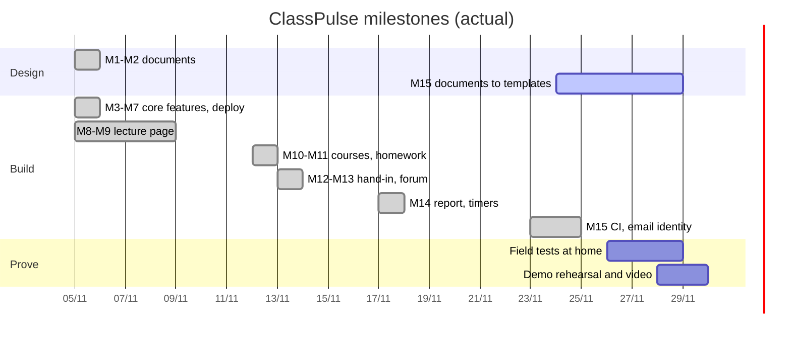

# Statement of Work: ClassPulse

> Assignment step 3. What is delivered, when, at what cost, and how each delivery is accepted.
> Requirements in the [SRS](04-srs.md) trace back to the deliverable IDs below (D-n).

## 1. Objectives

**Problem.** An in-person lecture runs on scattered tools: a paper sheet or a Moodle form for attendance (easy to fake), a separate app for polls, questions that never get asked, and feedback that arrives after the course is over. Recordings and homework pile up without anyone analysing them.

**Goals.**

| ID | Goal | Measured by |
|----|------|-------------|
| G-1 | Attendance that takes a student one tap and is hard to fake | NFR-01 (≤ 2 taps, ≤ 5 s); the anti-fraud checks of F2 |
| G-2 | The lecturer knows, during the lecture, who is lost and what they ask | F3, F4 live on the projector and the dashboard |
| G-3 | After the lecture, everyone gets the material, and the lecturer gets a report that helps improve the next one | F5, F7, F8 |
| G-4 | Homework feedback before the hand-in, and a draft grade for the lecturer | F6 |

**Background.** Assignment 2 of *Introduction to Software Engineering* (Ariel University): design a KISS, LLM-ready teaching tool, build it, and prove it in a 10-minute live demo in class. One developer, with an AI coding assistant as a tool.

## 2. Deliverables

| ID | Deliverable | Acceptance criterion | Accepted by |
|----|-------------|----------------------|-------------|
| D-1 | Public Git repository with a README (problem, scope, quick start) | A clean clone runs with the README commands; CI is green | CI run, reviewer |
| D-2 | [Tools report](02-tools-report.md) | Every chosen tool was tried for real (a spike or a field test) with a recorded result; every major choice has an ADR | Review |
| D-3 | Statement of Work (this document) | All six parts present; Zoom stated out of scope | Review |
| D-4 | [SRS](04-srs.md) | Every requirement is testable, has an ID, a priority and a source D-n; the traceability matrix has no Must requirement in Gap | `tools/trace.ts` in CI |
| D-5 | [Use cases](05-use-cases.md) | Every use case has actor, pre/postconditions, main and alternative flows and the requirements it covers | Review |
| D-6 | [SDD](06-sdd.md) | Every requirement is allocated to a component | Allocation table |
| D-7 | [EDD](07-edd/README.md): class, sequence and state diagrams, API docs | Class and method names match the code; all Mermaid renders | mermaid-cli, review |
| D-8 | [STP / STD](08-stp-std.md) | A test plan per class; numbered test cases traced to requirements | CI, trace matrix |
| D-9 | The web app (features F1–F10 below), deployed | Reachable over HTTPS from students' phones; all automated tests pass | CI, live URL |
| D-10 | [Demo plan](10-demo-plan.md) and the 10-minute live demo | Every demo step maps to a requirement; a backup video exists | The lecturer, in class |
| D-11 | [Conclusion](11-conclusion.md) | Results, plan vs. actual, retrospective | Review |

**D-9 features.**

| Feature | What it gives | Priority |
|---------|---------------|----------|
| F1 Attendance | Rotating QR, one-tap check-in, live list, Excel/CSV/Google Sheets export | Must |
| F2 Anti-fraud | AI headcount from a class photo; Roll-call and Visual Ping checks, live or after class | Must |
| F3 Live backchannel | "I'm lost" meter, questions with upvotes, course forum | Must |
| F4 Polls | From a slide (AI drafts) or written by hand, with an automatic close | Must |
| F5 Lecture summary and report | Summary for students; a short improvement report for the lecturer with a trend | Should |
| F6 Homework review | Hidden AI rubric, 2 feedback checks, one hand-in graded as a draft for the lecturer | Should |
| F7 Lecture page | Everything about one lecture in one place, also for those who missed it | Should |
| F8 Lecture comments | Anonymous comments for 7 days, exported to Excel | Should |
| F9 Administration | Admins appoint lecturers; lecturers create courses | Must |
| F10 Enrollment and timetable | Roster by email, weekly timetable, live lessons on the home screen | Must |

## 3. Scope

**In scope:** F1–F10 as specified in the SRS, in Hebrew (RTL), in the phone's browser and on a computer; one deployment that serves the class during the demo.

**Out of scope** (stated so that a new idea is not "included" by default):

| Item | Why |
|------|-----|
| **Zoom / Meet attendance** | The tool is for the people in the room: attendance is taken only by the QR on the projector. A student at home can follow a live lesson (forum, polls, "I'm lost") but is not marked present. |
| Moodle and the university's personal-information system | No access, and not needed for a pilot; the roster is a file the lecturer uploads. |
| Face recognition | Privacy: the class photo is used only to count people; students see a blurred copy. |
| A store app (iOS / Android) | KISS: the browser is enough; nothing to install. |
| Submitting grades to the university | The AI grade is a draft for the lecturer only. |
| Payments, multiple institutions | Not needed for one course. |

## 4. Milestones

Actual dates are taken from the Git history. M1–M7 were developed locally and landed as milestone commits on 5 Nov; from M10 on, every part is a separate commit.

| M | Content | Deliverables | Done |
|---|---------|--------------|------|
| M1 | Scaffold, README, tools report, SoW, SRS, use cases | D-1 … D-5 | 2026-11-05 |
| M2 | Components, class and sequence diagrams, testing strategy | D-6 … D-8 | 2026-11-05 |
| M3 | Attendance end to end, export | F1 | 2026-11-05 |
| M4 | AI headcount, Roll-call and Visual Ping | F2 | 2026-11-05 |
| M5 | Live backchannel and polls | F3, F4 | 2026-11-05 |
| M6 | Lecture summary, homework review | F5, F6 | 2026-11-05 |
| M7 | Production deploy, E2E, load test, coverage gate | D-9 | 2026-11-05 |
| M8–M9 | Lecture page, anonymous feedback, practice questions | F7, F8 | 2026-11-08 |
| M10 | Admin page, lecturer-created courses, roster, weekly timetable | F9, F10 | 2026-11-12 |
| M11 | Attendance in the room only; homework from a PDF | F1, F6 | 2026-11-12 |
| M12 | Lecturer notes for the rubric, 2 checks, one graded hand-in | F6 | 2026-11-13 |
| M13 | Live lessons open to the course, course forum, homework badge | F3, F7 | 2026-11-13 |
| M14 | Lecturer report and trend, comments export, after-class check, poll timer | F2, F4, F5, F8 | 2026-11-17 |
| M15 | CI, email identity, hand-written polls, documents in the lecturer's templates, field tests, backup video | D-1 … D-11 | 2026-11-30 (planned) |
| Demo | 10-minute live demo in class | D-10 | in class |

**Estimates for the remaining work (M15)**, three-point, in working days (E = (O + 4M + P) / 6):

| Task | O | M | P | E |
|------|---|---|---|---|
| CI and email identity | 1 | 1.5 | 3 | 1.7 |
| Documents to the templates (SoW … conclusion) | 3 | 4 | 7 | 4.3 |
| Spikes folder and field tests at home | 1 | 2 | 4 | 2.2 |
| Backup video and demo rehearsal | 0.5 | 1 | 2 | 1.1 |

## 5. Acceptance

- **Automated:** every push runs CI ([`.github/workflows/ci.yml`](../.github/workflows/ci.yml)): typecheck, unit tests with the coverage gate, build, integration tests against a real PocketBase, and browser tests on Chromium and WebKit. A red run blocks a deliverable.
- **Traceability:** the matrix in the SRS appendix is generated from the tests; a Must requirement without a passing test is a Gap and blocks D-4.
- **Review:** the documents (D-2 … D-8, D-11) are reviewed against the template of each assignment step.
- **Demo:** the lecturer accepts D-9 and D-10 in class.

## 6. Assumptions, roles and risks

**Assumptions and dependencies**
- Students have a smartphone with a camera and a current browser (iOS Safari or Android Chrome), and a Google account.
- The classroom has a projector and Wi-Fi or cellular coverage.
- The lecturer records lectures independently and uploads the file.
- The Gemini free tier is enough for one class; a mock provider keeps every feature demonstrable without it (NFR-08).
- Hosting on an existing VPS behind Cloudflare; Google OAuth for sign-in.

**Cost.** No licence cost. Hosting uses an existing shared server and the free tiers of Cloudflare and Gemini. The only cost is development time (section 4).

**Roles (RACI)** — R responsible, A accountable, C consulted, I informed.

| Activity | Developer (Gilad) | Lecturer (client) | AI coding assistant (tool) |
|----------|-------------------|-------------------|----------------------------|
| Requirements (README, SRS, use cases) | R, A | C | — |
| Architecture and design (SDD, EDD) | R, A | I | C |
| Implementation | R, A | — | C |
| Testing (STP/STD, CI) | R, A | I | C |
| Design reviews | R | C, A | — |
| Demo and acceptance | R | A | — |

**Rhythm and tools.** Small commits pushed after every part, with CI on each push; a check against the lecturer's class notes every week; GitHub for code and CI, PocketBase admin for data, Claude Code as the AI assistant.

**Risk matrix** (probability × impact):

| | Low impact | Medium impact | High impact |
|---|---|---|---|
| **High probability** | | R-3 | |
| **Medium probability** | R-6 | R-1, R-4, R-7 | R-2 |
| **Low probability** | | R-8 | R-5 |

**Risk register**

| ID | Risk | Mitigation | Status |
|----|------|-----------|--------|
| R-1 | Indoor GPS is inaccurate | The location check is lenient by default (flag only); the radius is configurable | Mitigated |
| R-2 | The AI service is down or out of quota during the demo | Mock provider; pre-processed summary; the SDK retries 429/5xx | Mitigated |
| R-3 | The LLM miscounts people in the photo | The count is advisory; the checks and the lecturer decide | Mitigated |
| R-4 | Slow classroom network | Small app; the QR window accepts up to 20 s of delay; manual approval as a fallback | Mitigated |
| R-5 | Loss of code or data | Remote repository, CI, server backups | Mitigated |
| R-6 | A long lecture video exceeds limits | 50 MB upload chunks, the Gemini Files API; a transcript as a fallback | Mitigated |
| R-7 | Scope creep from new requests | Every new request is planned first and goes through this document's scope list | Open |
| R-8 | One developer: illness or exam weeks | Small independent commits; documentation kept current; CI catches regressions | Open |
