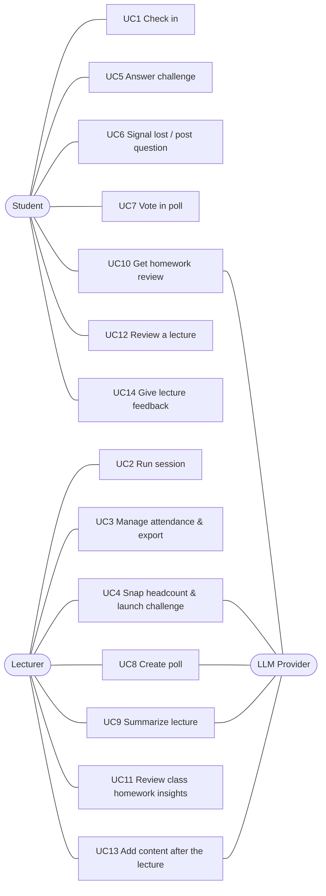

# Use Cases: ClassPulse

**Actors:** Student · Lecturer · LLM Provider (external) · System Timer

## User stories
| # | Story | FRs |
|---|-------|-----|
| UC1 | As a **student**, I scan the code on the board and tap once, so my attendance is recorded without lining up for a sheet. | ATT-02..06 |
| UC2 | As a **lecturer**, I click "Start session" and the projector shows a live code, so I don't spend lecture time on roll call. | ATT-01, 02 |
| UC3 | As a **lecturer**, I see who arrived live, approve late students and download a spreadsheet, so my records are complete. | ATT-07..09 |
| UC4 | As a **lecturer**, I snap a photo of the room and see whether check-ins match the people present, and challenge suspicious check-ins. | AF-01..08 |
| UC5 | As a **checked-in student**, I tap my seat on a blurred photo within 45 s to prove I'm in the room. | AF-04, 06 |
| UC6 | As a **student**, I press "I'm lost" or post a question (anonymously if I want), so the lecturer can react now. | BC-01..03 |
| UC7 | As a **student**, the poll appears on my phone and I vote with one tap. | PL-03 |
| UC8 | As a **lecturer**, I generate a question from my current slide and launch it in seconds. | PL-01..04 |
| UC9 | As a **lecturer**, I upload last week's recording and get chapters, review questions and the moments students got lost. | VS-01..05 |
| UC10 | As a **student**, I upload my homework and get rubric-based feedback and see where I stand versus the class. | HW-02, 03 |
| UC11 | As a **lecturer**, I see the class's common mistakes and suspicious similarity pairs. | HW-01, 04, BC-04 |
| UC12 | As a **student**, I open a lecture's page (even one I missed) to get the materials and review questions and read the answers to the class's questions. | LP-01..03 |
| UC13 | As a **lecturer**, after the lecture I answer open questions, publish review questions and upload the slides. | LP-02..04 |
| UC14 | As a **student**, when the lecture ends I tell the lecturer anonymously how it went, in one tap, so the next lecture can improve. | FB-01..03 |

## Detailed use cases

### UC1: Check in
- **Actor:** Student.
- **Preconditions:** a session is active; the projector shows the QR.
- **Main flow:**
  1. The student scans the QR with the phone camera; the browser opens `/c/:token`.
  2. The app is already signed in (PocketBase session) and reads the device id from local storage.
  3. The app requests geolocation, then shows the course name and a "I'm here" button.
  4. The student taps. The API runs the check-in rule chain (token → session active → duplicate student → device binding → geofence).
  5. A record is created and the student sees "✅ Checked in 10:02". The dashboard updates in realtime.
- **Alternate flows:**
  - **1a. First visit:** Google sign-in, then student ID entry, then continue at step 3.
  - **4a. Token expired:** "Code expired, scan again".
  - **4b. Already checked in:** show the existing record (idempotent).
  - **4c. Device already used by another student this session:** rejected; the student asks the lecturer for manual approval (UC3).
  - **4d. Beyond radius, lenient:** accepted and flagged. **Strict:** rejected with the distance shown.
  - **3a. Location denied:** treated as beyond radius (see 4d).
- **Postcondition:** exactly one `attendance_records` row exists for (session, student).

### UC2: Run session
- **Actor:** Lecturer.
- **Main flow:**
  1. The lecturer selects a course, sets the geofence mode and radius, and clicks "Start".
  2. The system creates the session with the lecturer's location and a fresh secret.
  3. The lecturer opens the projector view, which fetches a new token every 10 s.
  4. The lecturer clicks "End".
- **Alternate flow:** 2a. Location unavailable: geofence is disabled for this session, with a warning.
- **Postcondition:** when the session ends, clear photos are purged and new check-ins are rejected.

### UC3: Manage attendance and export
- **Actor:** Lecturer.
- **Main flow:**
  1. The dashboard lists records live.
  2. The lecturer searches for a student and clicks "Approve manually" with a note; the method is `manual`.
  3. The lecturer clicks "Export", then chooses xlsx or Google Sheet.
- **Alternate flow:** 2a. The lecturer removes a record, giving a reason; its status becomes `removed`, kept for audit.

### UC4: Snap headcount and launch a challenge
- **Actor:** Lecturer. **Secondary:** LLM Provider.
- **Main flow:**
  1. The lecturer clicks "Snap headcount" and takes or uploads a photo.
  2. The API sends the photo to the LLM, which returns the count, confidence and boxes. The API blurs the photo and stores both versions.
  3. The dashboard shows "N check-ins vs ~M people".
  4. If there is a mismatch, the lecturer chooses Roll-call or Visual Ping.
  5. When the challenge closes, the system labels each response; flagged records are highlighted on the heatmap.
  6. The lecturer removes the spoofed records.
- **Alternate flows:**
  - **2a. LLM failure or low confidence:** "Count unavailable"; the lecturer can still launch Roll-call.
  - **4a. No mismatch:** done.

### UC5: Answer Visual Ping
- **Actor:** Student, already checked in.
- **Main flow:**
  1. The challenge appears in realtime as a full-screen blurred photo with a countdown.
  2. The student taps their seat.
  3. The app confirms "Received".
- **Alternate flows:**
  - **2a. Timeout:** the response becomes `no_response`.
  - **2b. Second tap:** rejected; only the first tap counts.

### UC6: Signal lost / post a question
- **Actor:** Student.
- **Main flow:**
  1. The student taps "I'm lost", or writes a post and toggles "anonymous".
  2. The confusion meter and the feed update live on the dashboard.
- **Alternate flows:**
  - 1a. Offline: the post is queued in IndexedDB and sent when the connection returns.
  - 1b. After "I'm lost", the student writes what is unclear (optional); it is posted anonymously to the feed, where classmates can upvote it.

### UC7: Vote
- **Actor:** Student.
- **Main flow:**
  1. The lecturer opens a poll and the student's screen switches to it.
  2. The student taps an option.
  3. The projector's chart updates.
- **Alternate flow:** 2a. The poll is already closed: the results are shown instead.

### UC8: Create a poll
- **Actor:** Lecturer.
- **Main flow:**
  1. The lecturer taps "Photograph slide" (camera) or "Upload image" (gallery or computer).
  2. The LLM returns 3 MCQ drafts; the lecturer picks one and may edit it.
  3. The lecturer clicks "Open", then "Close & reveal".
- **Alternate flow:** 1a. The file is not an image or is over 10 MB: rejected.

### UC9: Summarize a lecture
- **Actor:** Lecturer.
- **Main flow:**
  1. The lecturer uploads a recording and sets the offset.
  2. The job is queued.
  3. The LLM produces the summary.
  4. The lecturer views the timeline with lost-spikes and clicks "Publish".
- **Alternate flows:**
  - **1a. No recording:** the lecturer uploads a transcript (vtt/srt/txt, e.g. from Zoom or Teams) instead.
  - **3a. Processing fails** (e.g. the provider is overloaded): the status becomes `failed` with a message, the temp file is deleted, and the lecturer can upload again or upload a transcript.

### UC10: Homework review (student)
- **Actor:** Student.
- **Main flow:**
  1. The student uploads a file.
  2. The system extracts the text and the LLM reviews it against the rubric.
  3. The student sees scores, strengths and fixes.
  4. Percentiles appear once at least 5 submissions exist.

### UC11: Class insights (lecturer)
- **Actor:** Lecturer.
- **Main flow:**
  1. The lecturer clicks "Analyze class".
  2. The system computes the distribution, groups common mistakes, and finds pairs with near-identical structure (fingerprint similarity ≥ 0.5, robust to renamed identifiers).
  3. The lecturer reviews the flagged pairs manually.

### UC12: Review a lecture (student)
- **Actor:** Student who attended at least one lecture of the course.
- **Main flow:**
  1. The student opens the course and picks a lecture (or follows "lecture page" after checking in).
  2. The page shows the published summary, materials, practice questions, the class polls with results, and the questions with the lecturer's answers.
  3. The student reads the numbered review questions and answers them for themselves.
- **Alternate flow:** 1a. The student missed this lecture: the page is read-only for questions (no posting or upvoting); everything else works.

### UC13: Add content after the lecture (lecturer)
- **Actor:** Lecturer. **Secondary:** LLM Provider.
- **Main flow:**
  1. On the lecture dashboard (also after "End lecture"), the lecturer writes an answer under an open question.
  2. The lecturer writes an open review question and publishes it, or uploads the slide deck (PDF), gets 8 AI drafts, unticks the ones they don't want and publishes the rest (or moves one into the text box to edit first).
  3. The lecturer taps "Upload file or image", picks a file and it uploads at once, or adds a link.
  4. Students in the course see each addition on the lecture page at once (realtime).
- **Alternate flows:**
  - 2a. An empty question: the publish button stays disabled.
  - 2b. The deck is not a PDF or an image (e.g. .pptx), or is over 50 MB: rejected; the screen says to save PowerPoint as PDF.
  - 3a. A file over 50 MB or a non-http(s) link: rejected.

### UC14: Give lecture feedback (student)
- **Actor:** Student who was checked in to the lecture.
- **Main flow:**
  1. The lecturer ends the lecture; the student's open page shows "How was the lecture?" with the note that the feedback is anonymous.
  2. The student picks one of four options and may add a comment.
  3. The student sends it and sees "thanks". The lecturer's dashboard shows the aggregate once 3 students have answered.
- **Alternate flows:**
  - 1a. The student already closed the page: the form waits on the lecture page for 24 hours.
  - 2a. The student taps "not now": nothing is sent.
  - 3a. The student already answered, or 24 hours have passed: the form is not shown.
