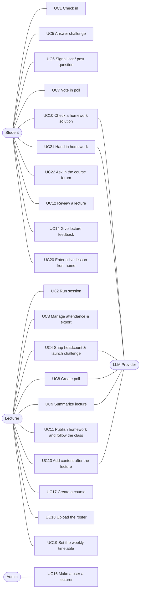

# Use Cases: ClassPulse

**Actors:** Student · Lecturer · Admin · LLM Provider (external) · System Timer

## User stories
| # | Story | FRs |
|---|-------|-----|
| UC1 | As a **student**, I scan the code on the board and tap once, so my attendance is recorded without lining up for a sheet. | ATT-02..06 |
| UC2 | As a **lecturer**, I click "Start session" and the projector shows a live code, so I don't spend lecture time on roll call. | ATT-01, 02 |
| UC3 | As a **lecturer**, I see who arrived live, approve late students and download a spreadsheet, so my records are complete. | ATT-07..09 |
| UC4 | As a **lecturer**, I snap a photo of the room and see whether check-ins match the people present, and challenge suspicious check-ins. | AF-01..08 |
| UC5 | As a **checked-in student**, I tap my seat on a blurred photo within 45 s to prove I'm in the room. | AF-04, 06 |
| UC6 | As a **student**, I press "I'm lost" or post a question (anonymously if I want), so the lecturer can react now. | BC-01..03 |
| UC7 | As a **student**, the poll appears on my phone and I vote with one tap. | PL-03 |
| UC8 | As a **lecturer**, I generate a question from my current slide and launch it in seconds. | PL-01..04 |
| UC9 | As a **lecturer**, I upload last week's recording and get chapters, review questions and the moments students got lost. | VS-01..05 |
| UC10 | As a **student**, before handing in my homework I upload my solution and get feedback on every section, up to 2 times, so I can fix it first. | HW-02, 04..06 |
| UC11 | As a **lecturer**, I publish the homework PDF with my instructions for the rubric, and follow the class: each student's checks and hand-in with the AI's grade, common mistakes and suspiciously similar hand-ins. | HW-01..03, 08..10, BC-04 |
| UC12 | As a **student**, I open a lecture's page (even one I missed) to get the materials and review questions and read the answers to the class's questions. | LP-01..03 |
| UC13 | As a **lecturer**, after the lecture I answer open questions, publish review questions and upload the slides. | LP-02..04 |
| UC14 | As a **student**, when the lecture ends I tell the lecturer anonymously how it went, in one tap, so the next lecture can improve. | FB-01..03 |
| UC16 | As the **admin**, I find a registered user and make them a lecturer, without touching the server. | AD-01 |
| UC17 | As a **lecturer**, I create my course myself. | AD-02 |
| UC18 | As a **lecturer**, I upload the course list I already have (Excel or CSV) once, so my students see the course without any link. | EN-01..04 |
| UC19 | As a **lecturer**, I set the course's weekly days and hours, so everyone sees it in their timetable and I can start the lesson in one tap. | TT-01..03 |
| UC20 | As a **student**, I open the app and see the lesson that is live now and my week, and I enter the lesson in one tap. | EN-03, TT-02..04 |
| UC21 | As a **student**, when my solution is ready I hand it in once from the same page, and see that it was handed in. | HW-07, 08 |
| UC22 | As a **student**, between lessons I ask in the course's forum and read the lecturer's answer there. | BC-06 |

## Detailed use cases

### UC1: Check in
- **Actor:** Student.
- **Preconditions:** a session is active; the projector shows the QR.
- **Main flow:**
  1. The student scans the QR with the phone camera; the browser opens `/c/:token`.
  2. The app is already signed in (PocketBase session) and reads the device id from local storage.
  3. The app requests geolocation, then shows the course name and a "I'm here" button.
  4. The student taps. The API runs the check-in rule chain (token → session active → duplicate student → device binding → geofence).
  5. A record is created and the student sees "✅ Checked in 10:02". The dashboard updates in realtime.
- **Alternate flows:**
  - **1a. First visit:** Google sign-in, then student ID entry, then continue at step 3.
  - **4a. Token expired:** "Code expired, scan again".
  - **4b. Already checked in:** show the existing record (idempotent).
  - **4c. Device already used by another student this session:** rejected; the student asks the lecturer for manual approval (UC3).
  - **4d. Beyond radius, lenient:** accepted and flagged. **Strict:** rejected with the distance shown.
  - **3a. Location denied:** treated as beyond radius (see 4d).
- **Postcondition:** exactly one `attendance_records` row exists for (session, student).

### UC2: Run session
- **Actor:** Lecturer.
- **Main flow:**
  1. The lecturer selects a course, sets the geofence mode and radius, and clicks "Start".
  2. The system creates the session with the lecturer's location and a fresh secret.
  3. The lecturer opens the projector view, which fetches a new token every 10 s.
  4. The lecturer clicks "End".
- **Alternate flow:** 2a. Location unavailable: geofence is disabled for this session, with a warning.
- **Postcondition:** when the session ends, clear photos are purged and new check-ins are rejected.

### UC3: Manage attendance and export
- **Actor:** Lecturer.
- **Main flow:**
  1. The dashboard lists records live.
  2. The lecturer searches for a student and clicks "Approve manually" with a note; the method is `manual`.
  3. The lecturer clicks "Export", then chooses xlsx or Google Sheet.
- **Alternate flow:** 2a. The lecturer removes a record, giving a reason; its status becomes `removed`, kept for audit.

### UC4: Snap headcount and launch a challenge
- **Actor:** Lecturer. **Secondary:** LLM Provider.
- **Main flow:**
  1. The lecturer clicks "Snap headcount" and takes or uploads a photo.
  2. The API sends the photo to the LLM, which returns the count, confidence and boxes. The API blurs the photo and stores both versions.
  3. The dashboard shows "N check-ins vs ~M people".
  4. If there is a mismatch, the lecturer chooses Roll-call or Visual Ping.
  5. When the challenge closes, the system labels each response; flagged records are highlighted on the heatmap.
  6. The lecturer removes the spoofed records.
- **Alternate flows:**
  - **2a. LLM failure or low confidence:** "Count unavailable"; the lecturer can still launch Roll-call.
  - **4a. No mismatch:** done.

### UC5: Answer Visual Ping
- **Actor:** Student, already checked in.
- **Main flow:**
  1. The challenge appears in realtime as a full-screen blurred photo with a countdown.
  2. The student taps their seat.
  3. The app confirms "Received".
- **Alternate flows:**
  - **2a. Timeout:** the response becomes `no_response`.
  - **2b. Second tap:** rejected; only the first tap counts.

### UC6: Signal lost / post a question
- **Actor:** Student.
- **Main flow:**
  1. The student taps "I'm lost", or writes a post and toggles "anonymous".
  2. The confusion meter and the feed update live on the dashboard.
- **Alternate flows:**
  - 1a. Offline: the post is queued in IndexedDB and sent when the connection returns.
  - 1b. After "I'm lost", the student writes what is unclear (optional); it is posted anonymously to the feed, where classmates can upvote it.
  - 1c. The lesson has ended: its forum is read-only and links to the course forum (UC22).

### UC7: Vote
- **Actor:** Student.
- **Main flow:**
  1. The lecturer opens a poll and the student's screen switches to it.
  2. The student taps an option.
  3. The projector's chart updates.
- **Alternate flow:** 2a. The poll is already closed: the results are shown instead.

### UC8: Create a poll
- **Actor:** Lecturer.
- **Main flow:**
  1. The lecturer taps "Photograph slide" (camera) or "Upload image" (gallery or computer).
  2. The LLM returns 3 MCQ drafts; the lecturer picks one and may edit it.
  3. The lecturer clicks "Open", then "Close & reveal".
- **Alternate flow:** 1a. The file is not an image or is over 10 MB: rejected.

### UC9: Summarize a lecture
- **Actor:** Lecturer.
- **Main flow:**
  1. The lecturer uploads a recording and sets the offset.
  2. The job is queued.
  3. The LLM produces the summary.
  4. The lecturer views the timeline with lost-spikes and clicks "Publish".
- **Alternate flows:**
  - **1a. No recording:** the lecturer uploads a transcript (vtt/srt/txt, e.g. from Zoom or Teams) instead.
  - **3a. Processing fails** (e.g. the provider is overloaded): the status becomes `failed` with a message, the temp file is deleted, and the lecturer can upload again or upload a transcript.

### UC10: Check a homework solution (student)
- **Actor:** Student who is a course member.
- **Preconditions:** the homework's rubric is ready; the student has not handed in.
- **Main flow:**
  1. The student opens the homework from the lesson's (or the course's) homework tab and reads the PDF.
  2. The student taps "Get feedback" and uploads one PDF or photos of a handwritten solution.
  3. The AI reviews it against the rubric (and the lecturer's instructions) in the background; the server computes the question and total scores.
  4. The student sees the feedback (score, what meets, what is missing, direction for each section, named by what it asks; the sections not answered on top) and how many checks are left.
- **Alternate flows:**
  - 2a. Not a course member: rejected.
  - 2b. Wrong file type, more than 10 photos or over 20 MB: rejected with a message.
  - 3a. The check fails (the model or the server): the student is told it did not count and can try again; the previous result stays.
  - 4a. Both checks were used: the button is gone; the student fixes the solution by the last feedback and hands in (UC21).

### UC11: Publish homework and follow the class (lecturer)
- **Actor:** Lecturer. **Secondary:** LLM Provider.
- **Main flow:**
  1. In the lesson's homework tab the lecturer enters a title, an optional due date, the homework PDF and, optionally, instructions to the AI for the rubric, and publishes.
  2. The AI reads the PDF and builds the rubric; the homework shows "open for hand-in". On the homework's page the lecturer sees the whole rubric, with the expected answer of each section.
  3. The lecturer follows the students: checks used, hand-in time, the AI's grade; opens any student's hand-in files and grading report, and the chart with names.
  4. The lecturer taps "Analyze hand-ins" for the common mistakes and the pairs of very similar hand-ins, and reviews those by hand.
- **Alternate flows:**
  - 2a. The AI cannot find questions in the PDF: the homework shows "failed" with "Try again".
  - 2b. The rubric is not what the lecturer wanted: they change the instructions and tap "Update rubric"; the AI builds it again. Once someone has handed in, this is locked.
  - 3a. Grading a hand-in failed: the lecturer taps "Try again" on that row.
  - 3b. The lecturer deletes the homework: its file, rubric, checks and hand-ins are removed.

### UC21: Hand in homework (student)
- **Actor:** Student who is a course member. **Secondary:** LLM Provider.
- **Preconditions:** the homework's rubric is ready; the student has not handed in; no check is running.
- **Main flow:**
  1. On the homework page the student taps "Final hand-in" and picks one PDF or photos.
  2. The app asks to confirm that this is final; the student confirms.
  3. The files are stored; the page shows "Handed in at …" (late, if after the due date) and links to the files.
  4. The AI grades the hand-in against the rubric in the background, for the lecturer only.
- **Alternate flows:**
  - 1a. Wrong file type, more than 10 photos or over 20 MB: rejected with a message.
  - 2a. The student cancels: nothing is sent.
  - 3a. Already handed in: rejected; no more checks either.

### UC12: Review a lecture (student)
- **Actor:** Student who attended at least one lecture of the course.
- **Main flow:**
  1. The student opens the course and picks a lecture (or follows "lecture page" after checking in).
  2. The page shows the published summary, materials, practice questions, the class polls with results, and the questions with the lecturer's answers.
  3. The student reads the numbered review questions and answers them for themselves.
- **Alternate flow:** 1a. The student missed this lecture: the page is read-only for questions (no posting or upvoting); everything else works.

### UC13: Add content after the lecture (lecturer)
- **Actor:** Lecturer. **Secondary:** LLM Provider.
- **Main flow:**
  1. On the lecture dashboard (also after "End lecture"), the lecturer writes an answer under an open question.
  2. The lecturer writes an open review question and publishes it, or uploads the slide deck (PDF), gets 8 AI drafts, unticks the ones they don't want and publishes the rest (or moves one into the text box to edit first).
  3. The lecturer taps "Upload file or image", picks a file and it uploads at once, or adds a link.
  4. Students in the course see each addition on the lecture page at once (realtime).
- **Alternate flows:**
  - 2a. An empty question: the publish button stays disabled.
  - 2b. The deck is not a PDF or an image (e.g. .pptx), or is over 50 MB: rejected; the screen says to save PowerPoint as PDF.
  - 3a. A file over 50 MB or a non-http(s) link: rejected.

### UC14: Give lecture feedback (student)
- **Actor:** Student who was checked in to the lecture.
- **Main flow:**
  1. The lecturer ends the lecture; the student's open page shows "How was the lecture?" with the note that the feedback is anonymous.
  2. The student picks one of four options and may add a comment.
  3. The student sends it and sees "thanks". The lecturer's dashboard shows the aggregate once 3 students have answered.
- **Alternate flows:**
  - 1a. The student already closed the page: the form waits on the lecture page for 24 hours.
  - 2a. The student taps "not now": nothing is sent.
  - 3a. The student already answered, or 24 hours have passed: the form is not shown.

### UC16: Make a user a lecturer (admin)
- **Actor:** Admin (an email listed in the server's `ADMIN_EMAILS`).
- **Main flow:**
  1. The admin opens "Manage users" from the home screen.
  2. The admin types part of a name, email or student ID.
  3. The admin taps "Make lecturer" on the right user. The user's next visit opens the lecturer home.
- **Alternate flows:**
  - 1a. Not an admin: the page says it is for admins only.
  - 3a. "Back to student" reverses it. The admin cannot change their own role.

### UC17: Create a course (lecturer)
- **Actor:** Lecturer.
- **Main flow:** on the lecturer home, the lecturer enters a course code and name and taps "New course". The course page opens on its students tab (UC18).
- **Alternate flow:** the lecturer already has a course with that code: rejected.

### UC18: Upload the roster (lecturer)
- **Actor:** Lecturer.
- **Main flow:**
  1. On the course page, students tab, the lecturer taps "Upload Excel or CSV" and picks the file the faculty gave them (or pastes a list).
  2. The system reads one student per row (ID and name in any column order), adds new students and updates names, and shows "added N, updated M" with any skipped lines.
  3. The table lists the roster; once a student signs up, their sign-up name appears next to the roster name.
- **Alternate flows:**
  - 2a. No row has a student ID: rejected ("no student IDs found").
  - 2b. An ID that lost its leading zero in Excel is restored to 9 digits.
  - 3a. A student who checked in but is not on the roster is listed under "checked in but not on the roster" with "Add".

### UC19: Set the weekly timetable (lecturer)
- **Actor:** Lecturer.
- **Main flow:**
  1. On the course page, timetable tab, the lecturer adds weekly meetings (day, from, to, room) and optional term dates, and saves.
  2. Enrolled students and the lecturer see the meetings in their weekly timetable.
  3. During a meeting the lecturer's home shows "Start the lesson now"; one tap opens the lesson with the usual defaults.
- **Alternate flows:** 1a. Two meetings overlap on the same day, or a meeting ends before it starts: rejected.

### UC20: Enter a live lesson from home (student)
- **Actor:** Student enrolled in the course.
- **Main flow:**
  1. The student opens the app. The home screen shows "Lesson live now" for each live lesson of their courses, the weekly timetable and their courses.
  2. The student taps the live lesson; it opens on its attendance tab.
  3. The attendance tab asks them to scan the QR in the room (UC1); after scanning they land on the forum tab.
- **Alternate flow:** 1a. No live lesson: the timetable shows the next meetings; each course opens its lessons, including past ones (UC12).

### UC22: Ask in the course forum (student)
- **Actor:** Student who is a course member. **Secondary:** Lecturer.
- **Main flow:**
  1. The student opens the course page, "Forum" tab (or "To the course forum" on a past lesson).
  2. The student writes a question, optionally anonymously, and sends it.
  3. Classmates see it live and upvote it.
  4. The lecturer, on the same tab, writes an answer; the question shows "answered" with the answer under it.
- **Alternate flows:**
  - 2a. Not a course member: rejected.
