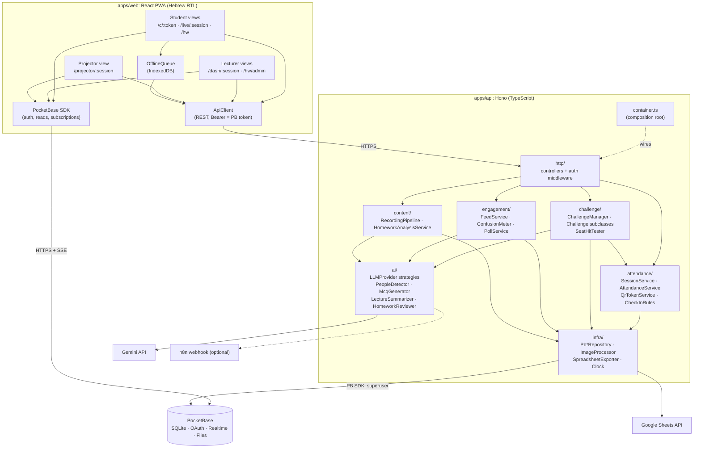

# Software Components: ClassPulse

## 1. Component diagram

## 2. Responsibilities

| Component | Responsibility | Depends on | Key interfaces |
|---|---|---|---|
| **Student views** | Check-in, live page (lost / feed / poll / challenge), homework upload | ApiClient, PB SDK | — |
| **Lecturer views** | Session control, live attendance table, headcount + heatmap, polls, summaries, homework insights | ApiClient, PB SDK | — |
| **Projector view** | Full-screen rotating QR (refreshes every 10 s), poll results, roll-call QR | ApiClient | — |
| **OfflineQueue** | Stores posts / lost signals while offline and replays them | ApiClient | — |
| **http/** | Routing, PB-token authentication, role guard, DTO validation, error mapping | domain services | REST endpoints |
| **attendance/** | Session lifecycle, QR tokens, check-in rule chain, manual approval, export | infra | `CheckInRule`, `GeofencePolicy` |
| **challenge/** | Headcount, challenge lifecycle, tap classification | attendance, ai, infra | `Challenge` (abstract) |
| **engagement/** | Feed, confusion level, polls | ai, infra | — |
| **content/** | Recording summary jobs, homework review and class insights | ai, infra | — |
| **ai/** | One place for all LLM access; prompts + JSON schemas per use case | Gemini / Claude / n8n | `LLMProvider`, `EmbeddingProvider` |
| **infra/** | Persistence (only layer that touches the PB SDK), image blur, spreadsheets, time | PB, sharp, SheetJS, Google API | `Repository<T>`, `ImageProcessor`, `SpreadsheetExporter`, `Clock` |
| **PocketBase** | Users / OAuth, storage, access rules, realtime push to clients | — | Collections (see the plan's schema) |

## 3. Architectural rules
1. **Dependency direction:** `http → domain → (ai, infra interfaces)`. Domain packages never import PB, sharp or the Gemini SDK directly.
2. **Read and write split.** Clients **read and subscribe** to PocketBase directly; collection rules filter what each user may see. Every **write that carries a business rule** goes through the API. Those collections have `createRule = null`, so only the superuser-authenticated API can write.
3. **Observer via PocketBase realtime.** PocketBase is the subject. Each client subscribes to the collections it displays, and an API write automatically notifies them. No custom websocket server is needed.
4. **Composition root.** `container.ts` builds every object once and injects its dependencies. Swapping Gemini for Mock or Claude changes only configuration (`LLM_PROVIDER`).
5. **Secrets stay server-side:** QR secrets, LLM keys and Google service-account credentials.
