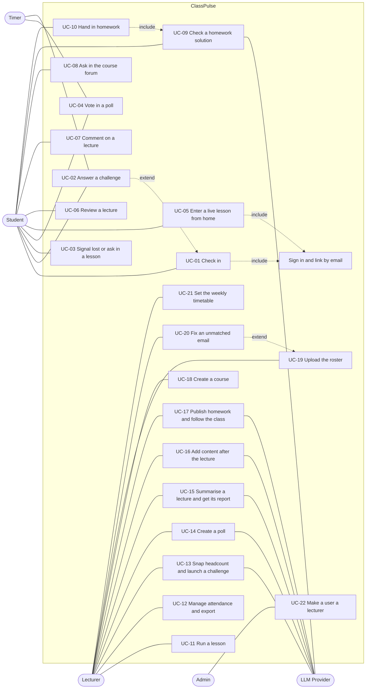
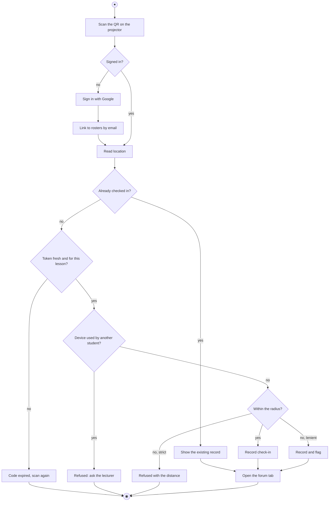
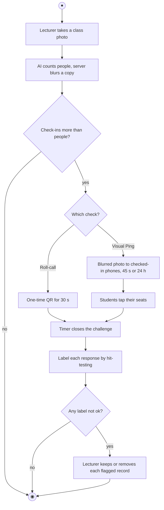
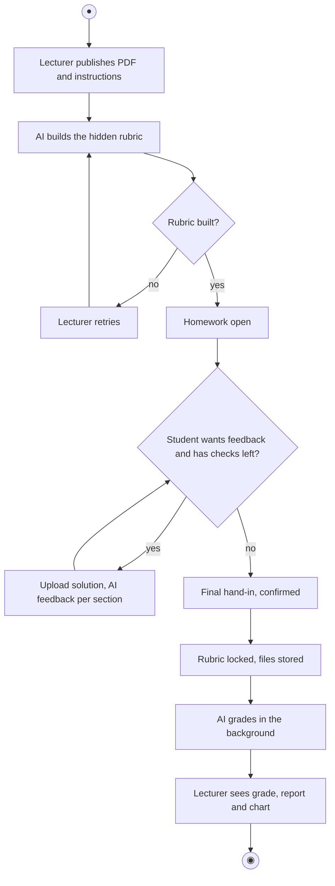
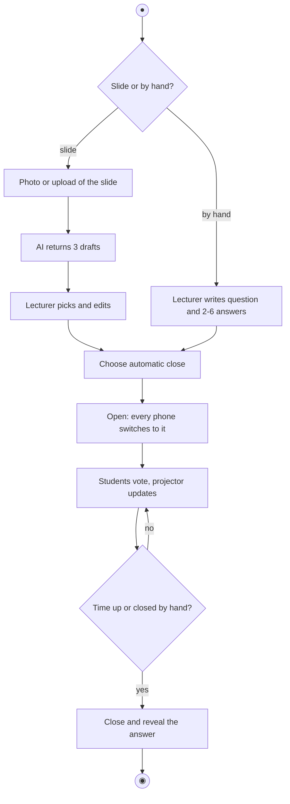

# Use Cases: ClassPulse

> Assignment step 5. How each actor reaches a goal, including the errors. Every use case lists the requirements it
> covers ([SRS](04-srs.md)); the traceability matrix (SRS appendix C) is built from these "Covers" lines.

## 1. Actors

| Actor | Kind | Goal |
|-------|------|------|
| Student | Person | Attend, take part, learn, get homework feedback |
| Lecturer | Person | Run the lesson, know the class, improve the lecture |
| Admin | Person | Decide who is a lecturer |
| LLM Provider | External system | Counts people, drafts questions, summarises, reviews |
| Timer | System | Closes polls and challenges when their time is up |

## 2. Use-case diagram

*include*: always performed as part of the use case. *extend*: optional, under a condition (UC-02 only if the lecturer launches a challenge; UC-20 only if a roster email does not match a sign-in; UC-10 requires the rubric used by UC-09).

## 3. Use cases

### Student

#### UC-01: Check in
- **Actor:** Student.
- **Preconditions:** a lesson is active; the projector shows the QR.
- **Main flow:**
  1. The student scans the QR with the phone camera; the browser opens `/c/:token`.
  2. The system finds the student's session and device id.
  3. The system asks for the location and records the check-in through the rule chain (duplicate → token → lesson active → device → location).
  4. The student sees "✓ attendance recorded 10:02" on the lesson's forum tab; the lecturer's list updates live.
- **Alternative flows:**
  - 2a. **First visit:** the student signs in with Google; the system links them to every roster with that email (no ID to type) and continues at step 3.
  - 3a. **Token expired:** "the code expired, scan again".
  - 3b. **Already checked in:** the existing record is shown.
  - 3c. **Device used by another student in this lesson:** refused; the student asks for manual approval (UC-12).
  - 3d. **Beyond the radius:** lenient — accepted and flagged; strict — refused with the distance.
  - 3e. **Location denied:** treated as beyond the radius (3d).
- **Postconditions:** exactly one attendance record exists for (lesson, student).
- **Covers:** FR-ATT-02, FR-ATT-03, FR-ATT-04, FR-ATT-05, FR-ATT-06, FR-EN-03, FR-EN-04, FR-TT-04

#### UC-02: Answer a challenge
- **Actor:** Student, checked in. **Secondary:** Timer.
- **Preconditions:** the lecturer launched a Visual Ping (UC-13).
- **Main flow:**
  1. The blurred class photo appears full screen with a countdown.
  2. The student taps their seat.
  3. The system confirms "received"; when the timer closes the challenge, each response gets its label.
- **Alternative flows:**
  - 1a. **After-class check:** a card at the top of the lesson page (and a notice on the home page) shows the photo and the closing time; the student taps there within 24 hours.
  - 1b. **Roll-call** instead: the projector shows a one-time QR for 30 s; the student scans it again.
  - 2a. Time runs out: the response becomes `no_response`.
  - 2b. A second tap: refused; the first counts.
- **Postconditions:** one response per student; a label other than `ok` flags the attendance record.
- **Covers:** FR-AF-03, FR-AF-04, FR-AF-06, FR-AF-09

#### UC-03: Signal lost or ask in a lesson
- **Actor:** Student, a course member.
- **Preconditions:** the lesson is live.
- **Main flow:**
  1. The student taps "I'm lost", or writes a question and chooses whether it is anonymous.
  2. The lecturer's meter and forum update live; classmates upvote the question.
- **Alternative flows:**
  - 1a. After "I'm lost", the student may write what is unclear; it is posted anonymously.
  - 1b. The lesson has ended: its forum is read-only and links to the course forum (UC-08).
  - 1c. The lecturer switched questions off: the box is replaced by a note pointing to the course forum and the lecture comments; "I'm lost" still works.
  - 1d. "I'm lost" pressed again within 60 s: refused.
- **Postconditions:** the lecturer sees how many are lost, never who; an anonymous post hides its author from everyone.
- **Covers:** FR-BC-01, FR-BC-02, FR-BC-03, FR-BC-05, FR-BC-07

#### UC-04: Vote in a poll
- **Actor:** Student, a course member. **Secondary:** Timer.
- **Preconditions:** the lecturer opened a poll (UC-14).
- **Main flow:**
  1. The student's screen switches to the poll, with its countdown.
  2. The student taps an option.
  3. The projector's chart updates.
- **Alternative flows:** 2a. The poll already closed (by the lecturer or the timer): the results and the correct answer are shown.
- **Postconditions:** one vote per student per poll.
- **Covers:** FR-PL-03, FR-PL-04, FR-PL-05

#### UC-05: Enter a live lesson from home
- **Actor:** Student on a course roster.
- **Preconditions:** the student signed in once.
- **Main flow:**
  1. The student opens the app. The home screen shows "lesson live now" for each live lesson of their courses, and the weekly timetable.
  2. The student taps the live lesson; it opens on its forum tab, where they can ask, vote and press "I'm lost".
  3. In the room, the student scans the QR to be marked present (UC-01).
- **Alternative flows:**
  - 1a. No live lesson: the timetable shows the next meetings; each course opens its lessons.
  - 1b. No course at all: the page says which email the student signed in with, to compare with the lecturer's list (UC-20).
- **Postconditions:** the student takes part without being marked present.
- **Covers:** FR-BC-05, FR-EN-03, FR-EN-05, FR-TT-02, FR-TT-03, FR-TT-04

#### UC-06: Review a lecture
- **Actor:** Student, a course member.
- **Preconditions:** the lecture exists (live or ended).
- **Main flow:**
  1. The student opens the course and picks a lecture.
  2. The page shows the published summary, materials, practice questions, closed polls with results, and the questions with the lecturer's answers.
  3. The student answers the review questions for themselves.
- **Alternative flows:** 1a. The student missed the lecture: everything is shown; questions go to the course forum.
- **Postconditions:** none (read-only).
- **Covers:** FR-LP-01, FR-LP-05, FR-VS-05

#### UC-07: Comment on a lecture
- **Actor:** Student, a course member. **Secondary:** Lecturer.
- **Preconditions:** the lecture ended less than 7 days ago; the student has not commented on it.
- **Main flow:**
  1. The open page shows "How was the lecture?" and says it is anonymous.
  2. The student picks one of four options and may add a comment, and sends it.
  3. The lecturer sees the aggregate once 3 students have answered, and can export the lecture's questions and comments.
- **Alternative flows:**
  - 1a. The student was not in class or closed the page: the form waits on the lecture page for 7 days.
  - 2a. "Not now": nothing is sent.
- **Postconditions:** one anonymous comment; no one can read who wrote it.
- **Covers:** FR-FB-01, FR-FB-02, FR-FB-03, FR-FB-04

#### UC-08: Ask in the course forum
- **Actor:** Student, a course member. **Secondary:** Lecturer.
- **Preconditions:** none.
- **Main flow:**
  1. The student opens the course page, forum tab (or "to the course forum" on a past lesson).
  2. The student writes a question, optionally anonymous.
  3. Classmates see it live and upvote it.
  4. The lecturer answers on the same tab; the question shows "answered".
- **Alternative flows:** 2a. Not a course member: refused.
- **Postconditions:** the question and its answer stay on the course forum.
- **Covers:** FR-BC-03, FR-BC-06, FR-LP-04

#### UC-09: Check a homework solution
- **Actor:** Student, a course member. **Secondary:** LLM Provider.
- **Preconditions:** the rubric is ready; the student has not handed in; a check is left.
- **Main flow:**
  1. The student opens the homework and reads the PDF.
  2. The student taps "get feedback" and uploads one PDF or photos.
  3. The AI reviews it against the rubric in the background; the server computes the scores.
  4. The student sees per section: score, what meets, what is missing, a direction; the unanswered sections on top; checks left.
- **Alternative flows:**
  - 2a. Wrong type, more than 10 photos or over 20 MB: refused.
  - 3a. The check fails: it does not count; the previous result stays.
  - 4a. Both checks used: the button is gone; the student hands in (UC-10).
- **Postconditions:** the practice file is not stored; the check count rises only on success.
- **Covers:** FR-HW-02, FR-HW-04, FR-HW-05, FR-HW-06, FR-HW-10

#### UC-10: Hand in homework
- **Actor:** Student, a course member. **Secondary:** LLM Provider.
- **Preconditions:** the rubric is ready; the student has not handed in; no check is running.
- **Main flow:**
  1. The student taps "final hand-in" and picks one PDF or photos.
  2. The app asks to confirm that this is final; the student confirms.
  3. The files are stored; the page shows "handed in at …" (late if after the due date).
  4. The AI grades it in the background, for the lecturer only.
- **Alternative flows:** 1a. Invalid files: refused. 2a. Cancel: nothing is sent. 3a. Already handed in: refused.
- **Postconditions:** one hand-in; no more checks; the files open only for the student and the lecturer.
- **Covers:** FR-HW-07, FR-HW-08, FR-LP-05

### Lecturer

#### UC-11: Run a lesson
- **Actor:** Lecturer.
- **Preconditions:** the lecturer has a course.
- **Main flow:**
  1. The lecturer taps "start the lesson now" on the home screen (or picks a course, a location mode and a radius).
  2. The system creates the lesson with the lecturer's location and a fresh secret.
  3. The lecturer opens the projector view; the QR changes every 10 s.
  4. The lecturer ends the lesson.
- **Alternative flows:** 2a. Location unavailable: the location check is off for this lesson, with a warning.
- **Postconditions:** after the end, clear photos are deleted, new check-ins are refused, and the comment form opens (UC-07).
- **Covers:** FR-ATT-01, FR-ATT-02, FR-AF-08, FR-TT-03

#### UC-12: Manage attendance and export
- **Actor:** Lecturer.
- **Preconditions:** a lesson exists.
- **Main flow:**
  1. The attendance tab lists check-ins live.
  2. The lecturer approves a student by hand with a note.
  3. The lecturer exports to Excel, CSV or Google Sheets; each row has name, email, time, method and flags.
- **Alternative flows:**
  - 2a. The lecturer removes a record with a reason; it stays as `removed` for audit.
  - 2b. A student not on the roster: "not on roster · add" adds them in one tap.
- **Postconditions:** the export matches the list on screen.
- **Covers:** FR-ATT-07, FR-ATT-08, FR-ATT-09, FR-EN-04

#### UC-13: Snap headcount and launch a challenge
- **Actor:** Lecturer. **Secondary:** LLM Provider.
- **Preconditions:** a lesson is active.
- **Main flow:**
  1. The lecturer takes or uploads a class photo.
  2. The LLM returns the count, confidence and boxes; the server blurs a copy.
  3. The lecturer sees "N checked in vs ~M people".
  4. On a mismatch, the lecturer launches Roll-call or Visual Ping (UC-02).
  5. When it closes, the labels appear on the heatmap; the lecturer keeps or removes each flagged record.
- **Alternative flows:**
  - 2a. LLM failure: "count unavailable"; Roll-call still works.
  - 4a. No mismatch: done.
  - 4b. **After class:** "after-class check (24 hours)", also after the lesson ended.
- **Postconditions:** flagged records wait for the lecturer's decision.
- **Covers:** FR-AF-01, FR-AF-02, FR-AF-03, FR-AF-04, FR-AF-05, FR-AF-06, FR-AF-07, FR-AF-09

#### UC-14: Create a poll
- **Actor:** Lecturer. **Secondary:** LLM Provider.
- **Preconditions:** a lesson is active.
- **Main flow:**
  1. The lecturer photographs the slide or uploads an image of it.
  2. The LLM returns 3 drafts; the lecturer picks one and may edit it.
  3. The lecturer keeps the automatic close (2 minutes) or picks 1 or 5 minutes or none, and opens it.
  4. It closes by itself and reveals the answer, or the lecturer closes it earlier.
- **Alternative flows:**
  - 1a. Not an image or over 10 MB: refused.
  - 1b. **No slide:** "write a question by hand": a question and 2–6 answers, the correct one optional; continue at step 3.
- **Postconditions:** opening a poll closes the previous one; results are kept on the lecture page.
- **Covers:** FR-PL-01, FR-PL-02, FR-PL-03, FR-PL-04, FR-PL-05

#### UC-15: Summarise a lecture and get its report
- **Actor:** Lecturer. **Secondary:** LLM Provider.
- **Preconditions:** the lesson exists.
- **Main flow:**
  1. The lecturer uploads a recording and sets its offset from the lesson start.
  2. The job is queued; the status is shown.
  3. The LLM writes the summary, then the lecturer report from the same source and the class signals.
  4. The lecturer reviews the timeline with the "I'm lost" spikes and publishes the summary.
  5. The lecturer reads the report (scores, tips at their moments, promises not kept); the course page shows the trend.
- **Alternative flows:**
  - 1a. No recording: a transcript instead.
  - 3a. Processing fails: `failed` with a message; upload again.
  - 3b. Only the report fails: the summary is kept; "rebuild report" works from the summary text.
- **Postconditions:** the recording file is deleted after processing; the report is never shown to students.
- **Covers:** FR-VS-01, FR-VS-02, FR-VS-03, FR-VS-04, FR-VS-05, FR-VS-06, FR-VS-07

#### UC-16: Add content after the lecture
- **Actor:** Lecturer. **Secondary:** LLM Provider.
- **Preconditions:** the lesson exists.
- **Main flow:**
  1. The lecturer answers an open question.
  2. The lecturer publishes a review question, or uploads the slide deck and publishes the AI drafts they keep.
  3. The lecturer uploads a file or adds a link.
  4. Course members see each addition at once.
- **Alternative flows:** 2a. Empty question: publishing is disabled. 2b. Not PDF or image, or over 50 MB: refused. 3a. Non-http(s) link: refused.
- **Postconditions:** the content is visible to course members only.
- **Covers:** FR-LP-02, FR-LP-03, FR-LP-04, FR-BC-04

#### UC-17: Publish homework and follow the class
- **Actor:** Lecturer. **Secondary:** LLM Provider.
- **Preconditions:** a course exists.
- **Main flow:**
  1. The lecturer enters a title, an optional due date, the PDF and optional instructions to the AI, and publishes.
  2. The AI builds the rubric; the lecturer sees it with the expected answer of each section.
  3. The lecturer follows each student: checks used, hand-in, AI grade and report, and the chart.
  4. "Analyse hand-ins" lists common mistakes and very similar hand-ins.
- **Alternative flows:**
  - 2a. No questions found in the PDF: "failed" with "try again".
  - 2b. New instructions: "update rubric", until the first hand-in.
  - 3a. Grading failed: "try again" on that row.
  - 3b. Delete the homework: files, rubric, checks and hand-ins go with it.
- **Postconditions:** the rubric is locked after the first hand-in.
- **Covers:** FR-HW-01, FR-HW-02, FR-HW-03, FR-HW-08, FR-HW-09, FR-HW-10

#### UC-18: Create a course
- **Actor:** Lecturer.
- **Preconditions:** the user is a lecturer (UC-22).
- **Main flow:** the lecturer enters a code and a name and taps "new course"; the course opens on its students tab (UC-19).
- **Alternative flows:** a course with that code already exists: refused.
- **Postconditions:** the course exists with no students.
- **Covers:** FR-AD-02

#### UC-19: Upload the roster
- **Actor:** Lecturer.
- **Preconditions:** the course exists.
- **Main flow:**
  1. On the students tab the lecturer uploads the Excel or CSV file (or pastes a list): one student per row, email and name (an ID is optional).
  2. The system adds new rows, updates names and missing emails, and shows "added N, updated M" with any skipped lines.
  3. Rows of students who already signed in are linked at once; the others show "not yet — check the email".
- **Alternative flows:**
  - 2a. No row has an email or an ID: refused.
  - 2b. An invalid email, or a repeated row: reported by line.
  - 2c. An ID that lost its leading zero in Excel is restored to 9 digits.
- **Postconditions:** each listed student sees the course as soon as they sign in with that email.
- **Covers:** FR-EN-01, FR-EN-02, FR-EN-03

#### UC-20: Fix an unmatched email
- **Actor:** Lecturer. **Secondary:** Student.
- **Preconditions:** a roster row is still waiting for a sign-in.
- **Main flow:**
  1. A student says they signed in but see no course; their home page shows the email they used (UC-05, 1b).
  2. The lecturer sees the banner "N on the list have not signed in yet" and the row marked "check the email".
  3. The lecturer taps ✏️, types the correct email and saves.
  4. The system links the row to the student who signed in with it; the row shows ✓ and the student sees the course after a refresh.
- **Alternative flows:**
  - 3a. Invalid email: refused.
  - 3b. The email is already on the roster: refused ("already on the list").
- **Postconditions:** the row belongs to the student who signs in with the new email; a link to the old email is dropped.
- **Covers:** FR-EN-02, FR-EN-03, FR-EN-05

#### UC-21: Set the weekly timetable
- **Actor:** Lecturer.
- **Preconditions:** the course exists.
- **Main flow:**
  1. The lecturer adds weekly meetings (day, from, to, room) and optional term dates, and saves.
  2. Members see the meetings in their timetable.
  3. During a meeting the lecturer's home shows "start the lesson now".
- **Alternative flows:** 1a. Overlapping meetings, or a meeting that ends before it starts: refused.
- **Postconditions:** the timetable replaces the previous one.
- **Covers:** FR-TT-01, FR-TT-02, FR-TT-03

### Admin

#### UC-22: Make a user a lecturer
- **Actor:** Admin (an email in the server's `ADMIN_EMAILS`).
- **Preconditions:** the user has signed in once.
- **Main flow:**
  1. The admin opens "manage users".
  2. The admin types part of a name, email or ID.
  3. The admin taps "make lecturer"; the user's next visit opens the lecturer home.
- **Alternative flows:** 1a. Not an admin: refused. 3a. "Back to student" reverses it; an admin cannot change their own role.
- **Postconditions:** the user's role is changed.
- **Covers:** FR-AD-01

## 4. Activity diagrams

### Check-in (UC-01)

### Challenge (UC-13, UC-02)

### Homework (UC-17, UC-09, UC-10)

### Poll (UC-14, UC-04)

## 5. User stories

| ID | Story | Acceptance criteria |
|----|-------|---------------------|
| US-01 | As a **student**, I scan the code and tap once, so my attendance is recorded without a paper sheet. | *Given* a live lesson and a fresh QR, *when* I scan it, *then* I see "attendance recorded" within 5 s and the lecturer's list shows me. |
| US-02 | As a **student**, I sign in with the email the lecturer has, so my courses appear without typing an ID. | *Given* my email is on a roster, *when* I sign in with Google for the first time, *then* the course is on my home screen. |
| US-03 | As a **lecturer**, I see whether check-ins match the people in the room, and check the suspicious ones. | *Given* 12 people in the photo and 15 check-ins, *when* I run a Visual Ping, *then* every check-in without a tap on a person is flagged for my decision. |
| US-04 | As a **student**, I press "I'm lost" so the lecturer can slow down, without anyone knowing it was me. | *Given* a live lesson, *when* I press it, *then* the meter rises and no screen shows my name. |
| US-05 | As a **lecturer**, I turn my slide into a question in seconds, and it closes by itself like a quiz. | *Given* a photo of a slide, *when* I pick a draft and open it with 2 minutes, *then* every phone shows it with a countdown and it closes and reveals the answer after 2 minutes. |
| US-06 | As a **lecturer**, I ask a question of my own when there is no slide. | *Given* no slide, *when* I write a question with 3 answers and open it, *then* students see and vote on it. |
| US-07 | As a **lecturer**, I get a short report that helps me improve the next lecture. | *Given* a processed recording, *when* I open the report, *then* I see three scores and 3–5 tips, each tied to a moment, and students cannot open it. |
| US-08 | As a **student**, I get feedback on my homework before handing it in, without being given the answer. | *Given* a published homework, *when* I upload my solution, *then* I see a score and a direction per section, and no section contains the answer. |
| US-09 | As a **lecturer**, I get a draft grade for every hand-in. | *Given* a hand-in, *when* grading finishes, *then* I see the total, per-section scores and the report, and the student sees only "handed in". |
| US-10 | As a **student who missed a lecture**, I still get its material and can ask about it. | *Given* an ended lecture, *when* I open it, *then* I see the materials and the answered questions and a link to ask in the course forum. |
| US-11 | As a **lecturer**, I export the comments and questions of a lecture to Excel. | *Given* 3 or more comments, *when* I export, *then* the file has the questions with answers and the comments without names or times. |
| US-12 | As a **lecturer**, I fix a student's mistyped email so they see my course. | *Given* a roster row waiting for a sign-in, *when* I correct the email to the one the student signed in with, *then* the row shows ✓ and the student sees the course. |
