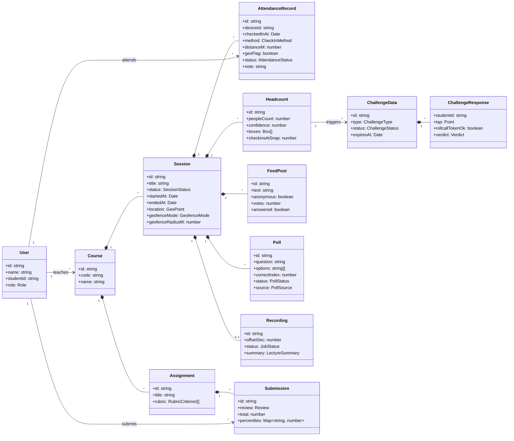
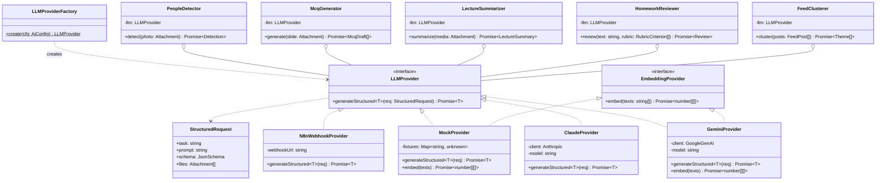
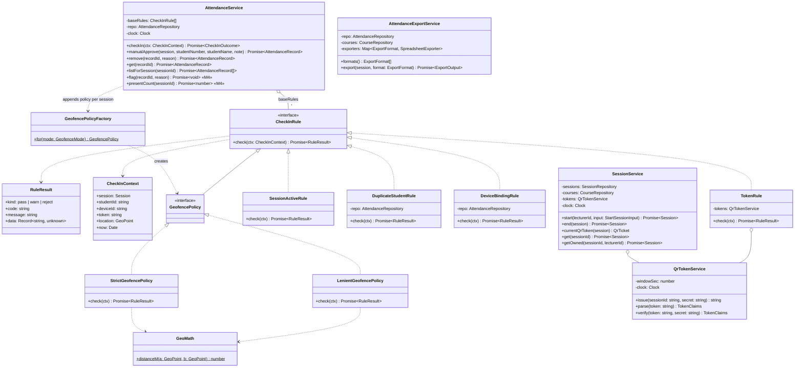
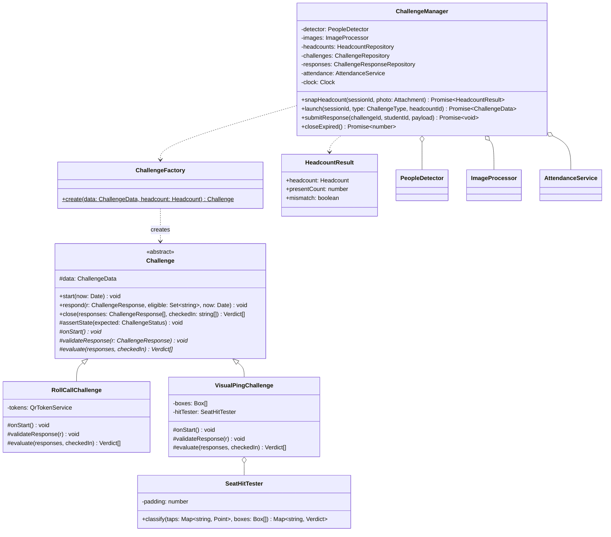
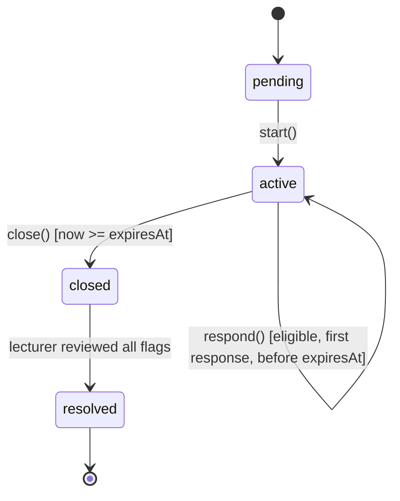

# Class Diagrams: ClassPulse API

Class and method names here are the contract for `apps/api/src`. One folder per package, one file per class.

**Design patterns used:**

| Pattern | Where |
|---|---|
| Strategy | `LLMProvider`, `GeofencePolicy`, `SpreadsheetExporter`, `ImageProcessor` |
| Factory | `LLMProviderFactory`, `GeofencePolicyFactory`, `ChallengeFactory`, `PollTemplateFactory` |
| Adapter | `N8nWebhookProvider` (n8n webhook → `LLMProvider`) |
| Chain of Responsibility | `CheckInRule[]` evaluated by `AttendanceService` |
| Template Method | `Challenge.start / respond / close` |
| State | `Challenge.status`: pending → active → closed |
| Repository | `Repository<T>` / `PbRepository<T>` |
| Observer | PocketBase realtime (subject) → web clients (observers) |
| Dependency Injection | `container.ts` composition root |

## 1. Domain model (entities)

## 2. `ai/`: Strategy + Adapter + Factory

Each AI service owns its prompt and JSON schema. All LLM output is schema-validated before use, so a malformed reply raises `LLMOutputError` and never reaches the domain.

## 3. `attendance/`: Chain of Responsibility + Strategy

**Chain semantics.** The rules run in order. The first `reject` stops the chain and becomes the error shown to the student. Each `warn` sets a flag on the record and evaluation continues. The order is DuplicateStudent, then Token, SessionActive, DeviceBinding and finally the GeofencePolicy chosen per session. DuplicateStudent runs first so that a student who is already present and reopens a stale link sees their own record, not "code expired". This is safe because the check can only return the caller's own record.

**Idempotency.** `DuplicateStudentRule` returns `reject` with code `ALREADY_CHECKED_IN`. `AttendanceService` maps that code to "return the existing record" (UC1 4b). Two concurrent scans by the same student are caught by the DB unique index `(session, student_number)`, and the loser also receives the existing record.

**Geofence and GPS accuracy.** `GeoMath.isInside` credits the accuracy the phone reports, capped at 100 m. A fix that is noisy but honest still passes, while a fix with 2 km accuracy cannot pass anywhere. A session with no location (the lecturer denied access) disables the geofence.

**Identity key.** Records are keyed by `studentNumber` (not by user id), so the lecturer can manually approve a student who never signed in.

## 4. `challenge/`: Template Method + State + Factory

**Classification rules in `SeatHitTester`** (coordinates are normalized to 0..1; each box is padded by `padding`, default 0.02):
- A tap inside no box is labelled `empty_seat`.
- When two or more taps fall in the same box, every one of them is labelled `collision`. The lecturer decides who is real.
- If a tap lies in two overlapping boxes, the nearest box centre wins.
- A checked-in student with no tap is labelled `no_response`.

## 5. `engagement/` and `content/`

```mermaid
classDiagram
  direction TB
  class FeedService {
    -posts: FeedPostRepository
    -votes: PostVoteRepository
    -clusterer: FeedClusterer
    +post(sessionId, authorId, text, anonymous) Promise~FeedPost~
    +upvote(postId, userId) Promise~void~
    +markAnswered(postId) Promise~void~
    +clusterOpen(sessionId) Promise~Theme[]~
  }
  class ConfusionMeter {
    -signals: LostSignalRepository
    -clock: Clock
    -cooldownSec: number
    +record(sessionId, studentId) Promise~boolean~
    +level(sessionId, windowSec) Promise~number~
    +series(sessionId, bucketSec) Promise~TimePoint[]~
  }
  class PollService {
    -polls: PollRepository
    -votes: PollVoteRepository
    -generator: McqGenerator
    +createFromTemplate(sessionId, kind: TemplateKind, question) Promise~Poll~
    +draftFromSlide(slide: Attachment) Promise~McqDraft[]~
    +create(sessionId, draft: McqDraft) Promise~Poll~
    +open(pollId) Promise~void~
    +vote(pollId, studentId, optionIndex) Promise~void~
    +close(pollId) Promise~PollResults~
  }
  class PollTemplateFactory {
    +options(kind: TemplateKind)$ string[]
  }
  class RecordingPipeline {
    -recordings: RecordingRepository
    -summarizer: LectureSummarizer
    -timeline: ConfusionMeter
    +enqueue(sessionId, file, offsetSec) Promise~Recording~
    +process(recordingId) Promise~void~
    +timelineSpikes(recordingId) Promise~Spike[]~
  }
  class HomeworkAnalysisService {
    -submissions: SubmissionRepository
    -reviewer: HomeworkReviewer
    -embeddings: EmbeddingProvider
    -extractor: TextExtractor
    +submit(assignmentId, studentId, file) Promise~Submission~
    +buildInsights(assignmentId) Promise~AssignmentInsights~
  }
  class PercentileCalculator {
    +percentile(value, population: number[])$ number
  }
  class SimilarityAnalyzer {
    +pairsAbove(vectors: Map~string, number[]~, threshold) SimilarPair[]
    +cosine(a: number[], b: number[])$ number
  }
  class TextExtractor {
    +extract(file: Attachment) Promise~string~
  }

  PollService ..> PollTemplateFactory
  PollService o-- McqGenerator
  FeedService o-- FeedClusterer
  RecordingPipeline o-- LectureSummarizer
  RecordingPipeline o-- ConfusionMeter
  HomeworkAnalysisService o-- HomeworkReviewer
  HomeworkAnalysisService o-- EmbeddingProvider
  HomeworkAnalysisService o-- TextExtractor
  HomeworkAnalysisService ..> PercentileCalculator
  HomeworkAnalysisService ..> SimilarityAnalyzer
```

## 6. `infra/`: Repository + Strategy

```mermaid
classDiagram
  direction TB
  class Repository~T~ {
    <<interface>>
    +get(id: string) Promise~T | null~
    +create(data: Omit~T, id~) Promise~T~
    +update(id: string, data: Partial~T~) Promise~T~
  }
  class PbRepository~T~ {
    <<abstract>>
    #pb: PocketBase
    #col: RecordService
    #expand: string
    #toEntity(rec)* T
    #toRecord(e: Partial~T~)* Record
    #first(filter, params) Promise~T | null~
  }
  class PbAttendanceRepository {
    +findBySessionAndStudentNumber(sessionId, studentNumber) Promise~AttendanceRecord~
    +findBySessionAndDevice(sessionId, deviceId) Promise~AttendanceRecord~
    +listBySession(sessionId) Promise~AttendanceRecord[]~
  }
  class PbSessionRepository {
    expands course to resolve lecturerId
  }
  class PbCourseRepository {
    +get(id) Promise~Course | null~
  }
  class PbHeadcountRepository {
    +purgeClearPhotos(sessionId) Promise~void~ «M4»
  }
  class InMemoryRepository~T~ {
    -items: Map~string, T~
  }
  class InMemoryAttendanceRepository
  class ImageProcessor {
    <<interface>>
    +blur(img: Buffer, sigma: number) Promise~Buffer~
  }
  class SharpImageProcessor
  class SpreadsheetExporter {
    <<interface>>
    +export(rows: AttendanceRow[], meta: SessionMeta) Promise~ExportOutput~
  }
  class XlsxExporter
  class CsvExporter
  class GoogleSheetsExporter {
    -sheets: sheets_v4.Sheets
    -spreadsheetId: string
  }
  class Clock {
    <<interface>>
    +now() Date
  }
  class SystemClock
  class FixedClock {
    +advance(ms: number) void
  }

  Repository~T~ <|.. PbRepository~T~
  Repository~T~ <|.. InMemoryRepository~T~
  PbRepository~T~ <|-- PbAttendanceRepository
  PbRepository~T~ <|-- PbSessionRepository
  PbRepository~T~ <|-- PbHeadcountRepository
  InMemoryRepository~T~ <|-- InMemoryAttendanceRepository
  ImageProcessor <|.. SharpImageProcessor
  SpreadsheetExporter <|.. XlsxExporter
  SpreadsheetExporter <|.. CsvExporter
  SpreadsheetExporter <|.. GoogleSheetsExporter
  Clock <|.. SystemClock
  Clock <|.. FixedClock
```

Queries are named methods on domain-specific repository interfaces, never raw PocketBase filter strings, so the PocketBase query language never leaks into the domain. Other repositories follow the same pattern (`PbChallengeRepository`, `PbPollRepository` and so on). Each domain-specific repository is an interface, for example `AttendanceRepository extends Repository<AttendanceRecord>`. Unit tests use `InMemoryRepository`-based fakes.

## 7. SOLID mapping
| Principle | Evidence |
|---|---|
| SRP | Each check-in rule, geofence policy and AI task is its own class; `SeatHitTester` is pure geometry |
| OCP | A new rule, challenge type, exporter or LLM vendor is a new class; existing code is unchanged |
| LSP | Any `LLMProvider`, `Challenge` subclass or `SpreadsheetExporter` can replace its base in tests and production |
| ISP | `LLMProvider` and `EmbeddingProvider` are separate, because Claude and n8n need not support embeddings |
| DIP | Services depend on `Repository`, `LLMProvider`, `Clock` and `ImageProcessor`; concrete classes are bound only in `container.ts` |
