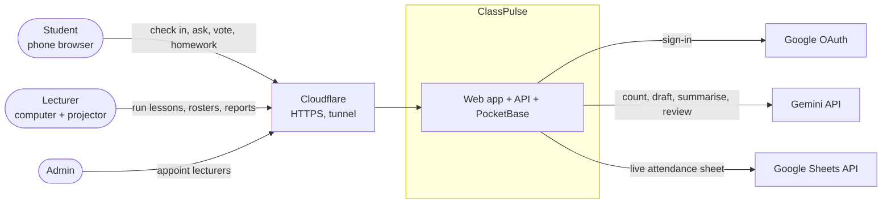
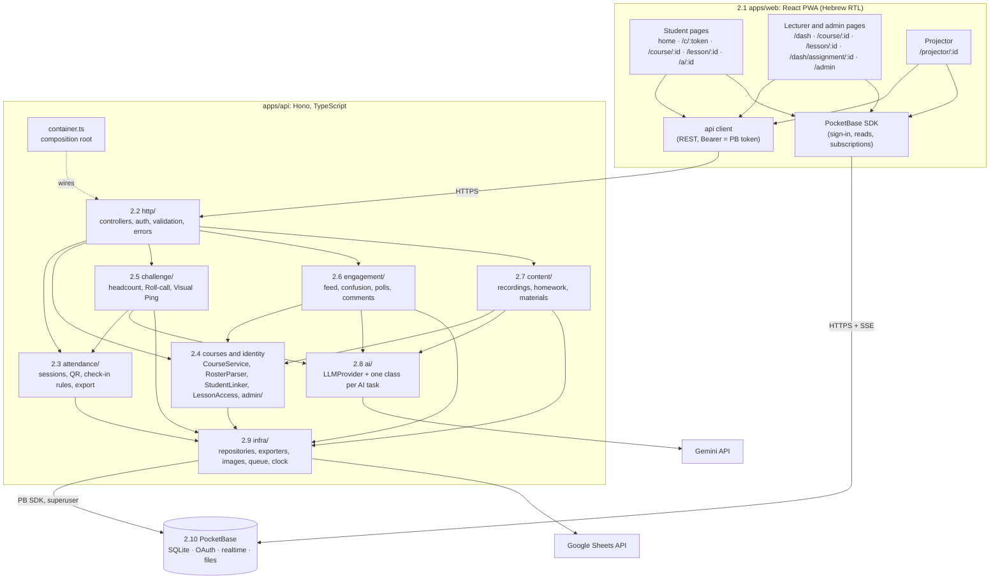
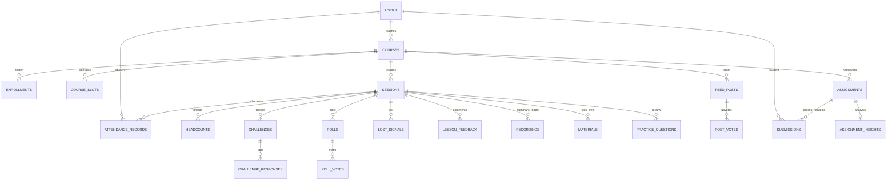
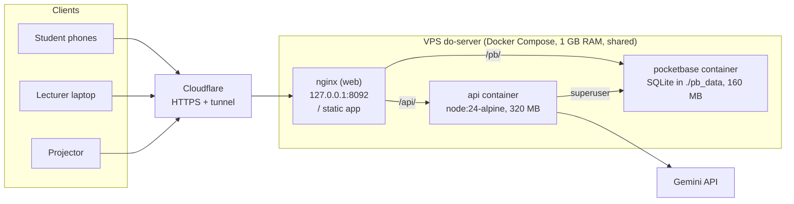

# Software Design Document (SDD): ClassPulse

> Assignment step 6. The parts of the whole system and how they connect. How each part is built inside is in the
> [EDD](07-edd/README.md). Other documents cite sections here as "SDD §n".

## 1. Context

Who uses the system and which outside systems it depends on.

## 2. Decomposition

### 2.1 Web client (`apps/web`)
Pages for students (phone layout), lecturers (wide layout) and the projector (full screen). Reads and live updates come straight from PocketBase (`useLiveRecords`); every write goes to the API. Hebrew RTL, Tailwind, nothing to install. **Interfaces used:** REST API, PocketBase SDK.

### 2.2 HTTP layer (`apps/api/src/http`)
One controller per area (Session, Attendance, Course, Challenge, Engagement, Poll, Content, LectureContent, Homework, Admin). Resolves the PocketBase token to a user, guards roles per route, validates bodies, and maps domain errors to HTTP status codes. Holds no business rules.

### 2.3 Attendance (`attendance/`)
Lesson lifecycle (`SessionService`), rotating HMAC tokens (`QrTokenService`), the check-in rule chain (`DuplicateStudentRule → TokenRule → SessionActiveRule → DeviceBindingRule`, then a `GeofencePolicy`), manual approval, and the attendance export (`AttendanceExportService`).

### 2.4 Courses and identity (`attendance/` + `admin/`)
Courses, rosters and the weekly timetable (`CourseService`, `RosterParser`); linking a signed-in student to roster rows by email (`StudentLinker`); who may take part in a live lesson (`LessonAccess`); admins appoint lecturers (`UserAdminService`).

### 2.5 Anti-fraud (`challenge/`)
Headcount from a class photo, the challenge lifecycle (`ChallengeManager`, `Challenge` with `RollCallChallenge` and `VisualPingChallenge`), and labelling taps against person boxes (`SeatHitTester`).

### 2.6 Engagement (`engagement/`)
"I'm lost" meter (`ConfusionMeter`), lesson and course forum (`FeedService`), polls with timers (`PollService`), anonymous lecture comments (`FeedbackService`) and their export (`CommentsExportService`).

### 2.7 Content (`content/`)
Recording upload and processing into a summary and a lecturer report (`RecordingPipeline`, `LessonSignals`), homework rubric, checks, hand-ins and grading (`HomeworkAnalysisService`, `ScoreCalculator`, `Fingerprinter`, `SimilarityAnalyzer`, `TextExtractor`), materials and practice questions (`MaterialService`, `PracticeService`).

### 2.8 AI (`ai/`)
The only place that talks to a model. `LLMProvider` (Strategy) with `GeminiProvider` and `MockProvider`, chosen by `LLMProviderFactory`. One class per task owns its prompt, JSON schema and output validation: `PeopleDetector`, `McqGenerator`, `FeedClusterer`, `LectureSummarizer`, `LectureCoach`, `HomeworkGuideGenerator`, `HomeworkReviewer`, `PracticeQuestionGenerator`.

### 2.9 Infrastructure (`infra/`)
Repositories (`Pb*Repository` for production, `InMemory*` for tests), spreadsheet exporters (xlsx, CSV, Google Sheets), image blur (`ImageProcessor`, sharp), chunked uploads (`UploadStore`), the background job queue (`BackgroundQueue`), per-key locks (`KeyedLock`) and time (`Clock`).

### 2.10 PocketBase
Accounts and Google sign-in, the database (SQLite), file storage and realtime push. Its list/view rules decide what each user may read and which live events they receive; collections written by the API have no create/update rule. Schema as code in `pocketbase/pb_migrations`.

## 3. Interfaces

| From → to | Interface | What goes through it |
|-----------|-----------|----------------------|
| Web → API | REST over HTTPS, JSON, `Authorization: Bearer <PocketBase token>` | Every write with a business rule ([API docs](07-edd/README.md#api)) |
| Web → PocketBase | PocketBase SDK: queries and server-sent events | Reads and live updates, filtered by the collection rules |
| API → PocketBase | PocketBase SDK as superuser, behind `Repository` interfaces | All writes, hidden fields |
| Domain → AI | `LLMProvider.generateStructured({task, prompt, schema, files})` | Structured JSON, validated by the task class |
| Domain → exports | `SpreadsheetExporter.export(table, meta)` | A table to xlsx, CSV or a Google Sheet |
| Domain → time, images | `Clock`, `ImageProcessor` | Injected, so tests use fixed time and fake images |

## 4. Data

Main entities (the full list of fields, and which are hidden, is the [data dictionary](04-srs.md#b-data-dictionary)).

**Identity.** A student is known by the email they sign in with. Every user gets a *student key* (`users.student_id`): the 9-digit ID when a roster gives one, otherwise a generated 12-digit key. Records that belong to a student (check-ins, votes, submissions) store that key, and a roster row becomes the student's when the key is written into it (`StudentLinker`).

**Privacy by hidden fields.** Anonymous authors, "I'm lost" identities, the poll's correct answer until it closes, challenge and QR secrets, the homework rubric and the lecturer's notes, hand-in grades, copy-detection fingerprints and the lecturer report are hidden fields: only the API can read them. Every one has an integration test against the real PocketBase.

## 5. Deployment

- One public hostname, so the browser sees one origin (no CORS); the web build uses `VITE_PB_URL=/pb`.
- Nothing listens on a public port; HTTPS (needed for the camera and location) ends at Cloudflare.
- The PocketBase admin UI is refused through Cloudflare and used only through an SSH tunnel.
- `deploy/deploy.sh` builds locally, ships the build and the migrations, and runs `docker compose up`; secrets live only in the server's `.env`.
- The API is single-instance by design (in-memory job queue and locks).

## 6. Rationale

| Decision | Alternatives | Why this one | Record |
|----------|--------------|--------------|--------|
| PocketBase for data, sign-in and realtime | Supabase, Firebase | One binary, self-hosted, realtime and file storage included, schema as code | [ADR-001](adr/ADR-001-database.md) |
| A separate TypeScript API for business rules | PocketBase JS hooks | Real classes that map to the class diagrams, unit-testable without a database | [Tools report](02-tools-report.md) |
| Clients read PocketBase directly, write through the API | Everything through the API | Live updates for free (Observer), and rules stay in one place | §2.10 |
| The LLM behind an interface | Calling Gemini from each service | Swap the vendor or use the mock without touching services (NFR-06, NFR-08) | §2.8 |
| Anti-fraud by counting, not by recognising faces | Face recognition | Privacy (NFR-04); the lecturer keeps the decision | [Tools report](02-tools-report.md) |
| Hosting on an existing VPS behind Cloudflare | Render, Fly.io | No cold start during the demo; HTTPS for the camera | [Tools report](02-tools-report.md) |

## 7. Requirement allocation

Every requirement of the [SRS](04-srs.md) is allocated to the component that implements it (the web client, §2.1, shows all of them and is not repeated).

| Component | Requirements |
|-----------|--------------|
| §2.3 Attendance | FR-ATT-01 … FR-ATT-09 |
| §2.4 Courses and identity | FR-AD-01, FR-AD-02, FR-EN-01 … FR-EN-05, FR-TT-01 … FR-TT-04, FR-BC-05 |
| §2.5 Anti-fraud | FR-AF-01 … FR-AF-09 |
| §2.6 Engagement | FR-BC-01 … FR-BC-04, FR-BC-06, FR-BC-07, FR-PL-01 … FR-PL-05, FR-FB-01 … FR-FB-04 |
| §2.7 Content | FR-VS-01 … FR-VS-07, FR-HW-01 … FR-HW-10, FR-LP-01 … FR-LP-05 |
| §2.8 AI | The AI parts of FR-AF-01, FR-BC-04, FR-PL-02, FR-VS-03, FR-VS-06, FR-HW-01, FR-HW-04, FR-HW-08, FR-LP-02 |
| §2.9 Infrastructure | FR-ATT-09 and FR-FB-04 (exporters), FR-AF-04 (blur), FR-VS-01 (chunked upload) |
| §2.10 PocketBase | NFR-03, NFR-04 (access rules, hidden fields), the realtime parts of FR-ATT-07, FR-PL-03, FR-PL-04 |
| Whole system | NFR-01, NFR-02, NFR-05 … NFR-08 |
