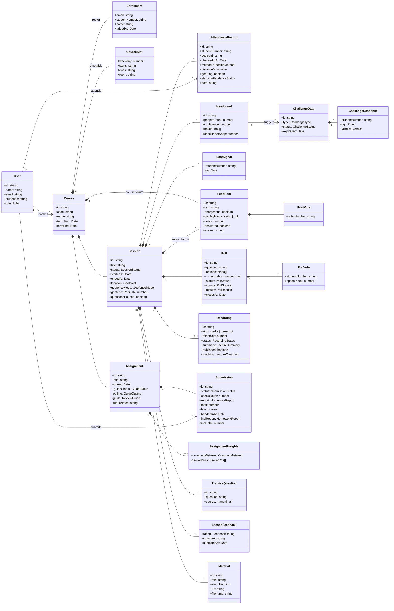
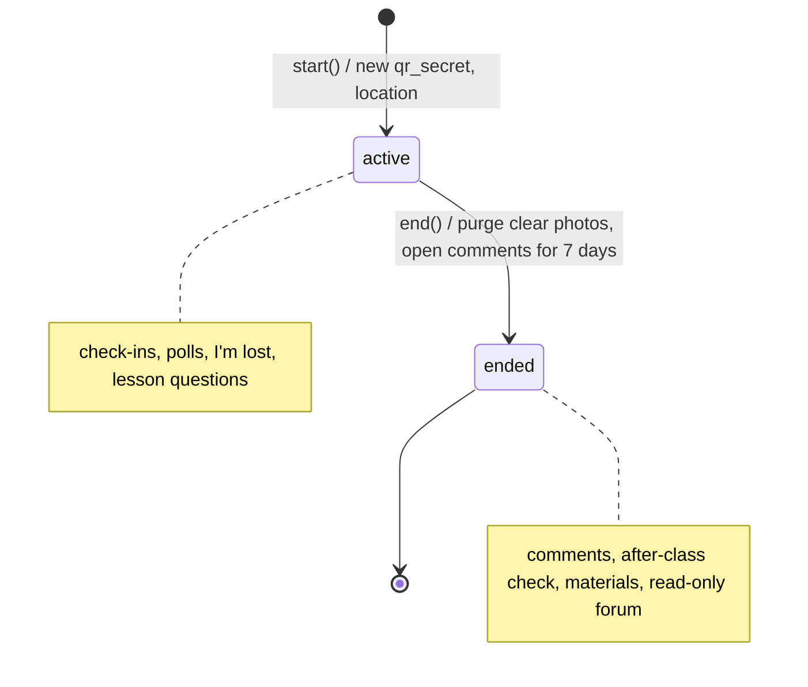
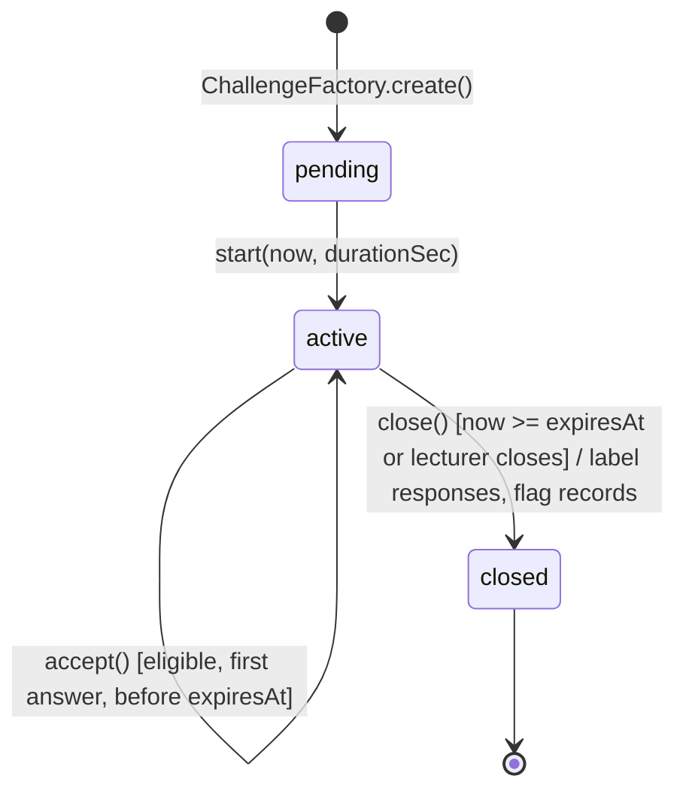
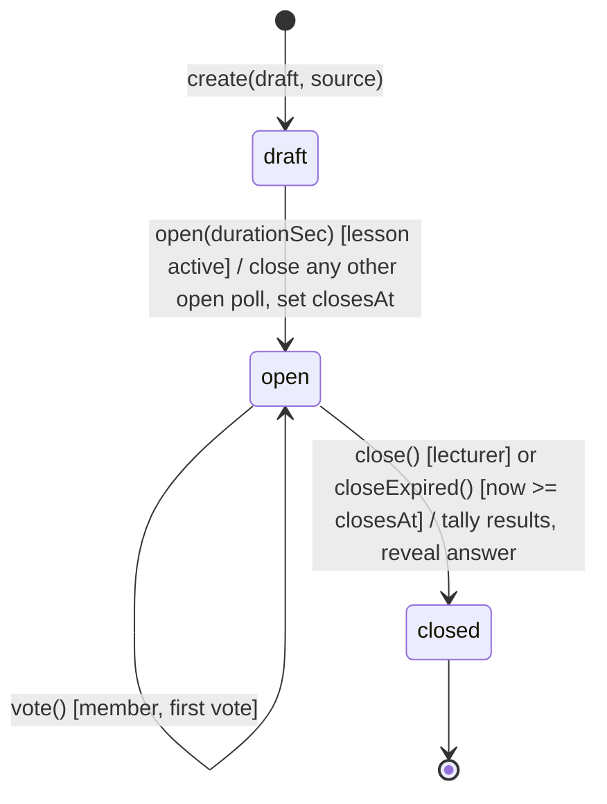
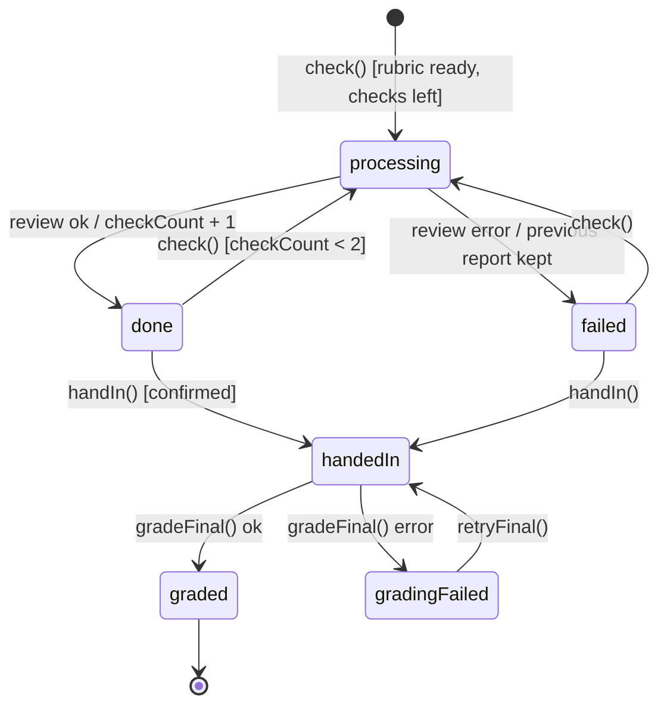
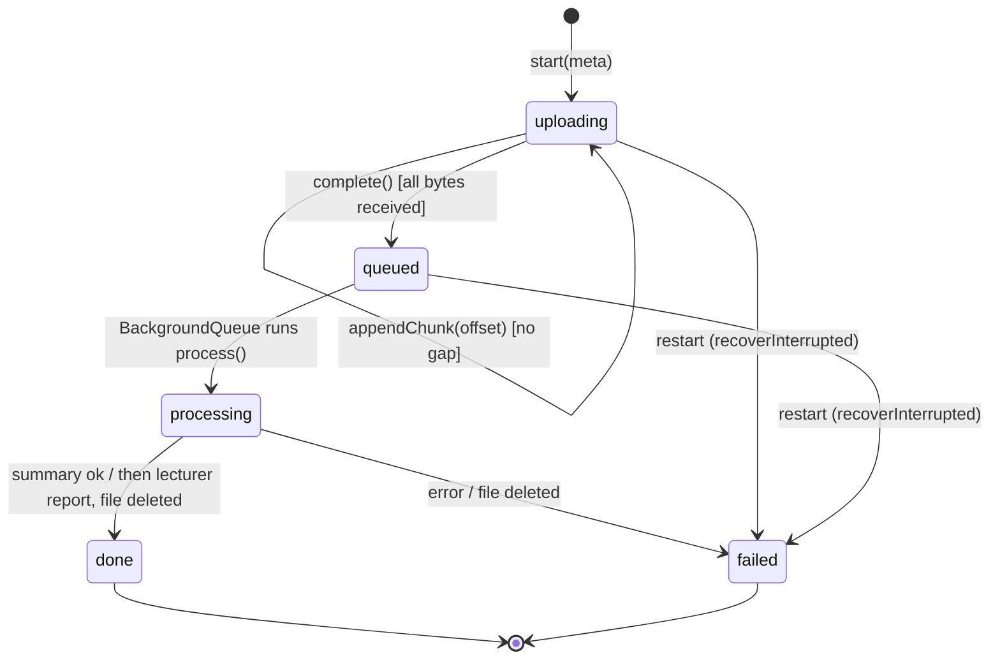

# Engineering Design (EDD): ClassPulse

> Assignment step 7. How each component is built: low-level classes, algorithms, data, sequences, errors,
> configuration, alternatives and tests. The whole-system view is the [SDD](../06-sdd.md). Class and method names here
> are the contract for `apps/api/src`: one folder per package, one file per class.

## Component EDDs

| EDD | Package | SDD | Requirements |
|-----|---------|-----|--------------|
| [EDD-Attendance](attendance.md) | `attendance/` (sessions, check-in, export) | §2.3 | FR-ATT |
| [EDD-Courses](courses.md) | `attendance/` (courses, roster, email identity), `admin/` | §2.4 | FR-AD, FR-EN, FR-TT |
| [EDD-AntiFraud](anti-fraud.md) | `challenge/` | §2.5 | FR-AF |
| [EDD-LiveClass](live-class.md) | `engagement/` | §2.6 | FR-BC, FR-PL, FR-FB |
| [EDD-LectureContent](lecture-content.md) | `content/` (recordings, materials, practice) | §2.7 | FR-VS, FR-LP |
| [EDD-Homework](homework.md) | `content/` (homework) | §2.7 | FR-HW |
| [EDD-AI](ai.md) | `ai/` | §2.8 | the AI parts of the above |
| [EDD-Infrastructure](infra.md) | `infra/` | §2.9 | exports, storage, time |

Every component EDD has the same eight parts: 1 classes, 2 algorithms and rules, 3 data, 4 sequences, 5 errors and edge cases, 6 configuration and performance, 7 alternatives, 8 testing. In the sequence diagrams `PB` is PocketBase, reached through the `Pb*Repository` classes.

## Design patterns

| Pattern | Where |
|---------|-------|
| Strategy | `LLMProvider`, `GeofencePolicy`, `SpreadsheetExporter`, `ImageProcessor` |
| Factory | `LLMProviderFactory`, `GeofencePolicyFactory`, `ChallengeFactory` |
| Adapter | `GeminiProvider` (the Google GenAI SDK behind `LLMProvider`) |
| Chain of Responsibility | `CheckInRule[]` evaluated by `AttendanceService` |
| Template Method | `Challenge.start / accept / close` with `validatePayload` and `evaluate` in subclasses |
| State | `Challenge`, `Poll`, `Session`, `Submission`, `Recording` (diagrams below) |
| Repository | `Repository<T>`, `PbRepository<T>`, `InMemoryRepository<T>` |
| Observer | PocketBase realtime (subject) → web clients (observers) |
| Dependency injection | `container.ts` composition root |

## Domain model



Fields marked `-` are hidden in PocketBase: only the API reads them ([data dictionary](../04-srs.md#b-data-dictionary)).

## State machines

Each machine is tested transition by transition (TC references in the [STD](../08-stp-std.md)).

### Session


### Challenge


### Poll


### Submission (homework)


### Recording


## API

The contract for anyone calling the ClassPulse API.

### Overview and authentication
- **Base URL:** `https://classpulse.giladautomation.com/api` (locally `http://localhost:8787`, or `/api` through the Vite proxy). No version prefix: the API and the web app are deployed together.
- **Authentication:** sign in through PocketBase (Google OAuth for students, password for lecturers in tests), then send `Authorization: Bearer <PocketBase token>`. Every route except `GET /health` needs it (`401 UNAUTHENTICATED`).
- **Roles:** routes marked **L** need a lecturer, and the lecturer must own the course or lesson (`403` or `404` otherwise); **A** needs an admin (an email in `ADMIN_EMAILS`); others are for any signed-in user, and the service checks course membership.
- **Bodies:** JSON, except file uploads (`multipart/form-data`) and recording chunks (raw bytes).

### Endpoint reference

| Method | Path | Role | Purpose | Body / query |
|--------|------|------|---------|--------------|
| GET | `/health` | — | Liveness | — |
| GET | `/me` | any | Is the caller an admin | — |
| POST | `/me/link` | any | Link the caller to roster rows by sign-in email; give them a student key | — |
| GET | `/admin/users` | A | Find users | `?q=` |
| POST | `/admin/users/:id/role` | A | Make a lecturer or student | `{role}` |
| POST | `/courses` | L | Create a course | `{code, name}` |
| POST | `/courses/:id/roster` | L | Import a roster | file, or `{text}` |
| POST | `/courses/:id/enrollments` | L | Add one student | `{email?, studentNumber?, name?}` |
| PUT | `/courses/:id/enrollments/:eid` | L | Fix a roster email | `{email}` |
| DELETE | `/courses/:id/enrollments/:eid` | L | Remove a student | — |
| PUT | `/courses/:id/timetable` | L | Replace the weekly timetable | `{slots[], termStart?, termEnd?}` |
| POST | `/sessions` | L | Start a lesson | `{courseId, title?, geofenceMode, geofenceRadiusM, location?}` |
| POST | `/sessions/:id/end` | L | End a lesson | — |
| PUT | `/sessions/:id/questions` | L | Questions only after class | `{paused}` |
| GET | `/sessions/:id/qr` | L | Current QR token | — |
| POST | `/sessions/:id/attendance` | L | Manual approval | `{studentNumber, studentName, note}` |
| GET | `/sessions/:id/export` | L | Attendance export | `?format=xlsx\|csv\|sheets` |
| GET | `/sessions/:id/comments/export` | L | Questions and comments export | `?format=xlsx\|csv\|sheets` |
| POST | `/checkins` | any | Check in | `{token, deviceId, location?}` |
| DELETE | `/attendance/:id` | L | Remove a record | `?reason=` |
| POST | `/attendance/:id/confirm` | L | Keep a flagged record | — |
| POST | `/sessions/:id/headcounts` | L | Class photo → count and boxes | file `photo` |
| POST | `/sessions/:id/challenges` | L | Launch Roll-call or Visual Ping | `{type, headcountId?, afterClass?}` |
| GET | `/challenges/:id/qr` | L | Roll-call QR token | — |
| POST | `/challenges/:id/close` | L | Close a challenge early | — |
| POST | `/challenges/:id/responses` | any | Tap or roll-call scan | `{x, y}` or `{token}` |
| POST | `/sessions/:id/lost` | any | "I'm lost" (the optional note is a separate anonymous post) | — |
| GET | `/sessions/:id/confusion` | L | Confusion level | — |
| POST | `/sessions/:id/posts` | any | Ask in a live lesson | `{text, anonymous}` |
| POST | `/courses/:id/posts` | any | Ask in the course forum | `{text, anonymous}` |
| POST | `/posts/:id/votes` | any | Upvote | — |
| POST | `/posts/:id/answered` | L | Mark answered | `{answered}` |
| POST | `/posts/:id/answer` | L | Write an answer | `{text}` |
| POST | `/sessions/:id/themes` | L | AI grouping of open questions | — |
| GET | `/sessions/:id/feedback/status` | any | Can I comment | — |
| POST | `/sessions/:id/feedback` | any | Anonymous comment | `{rating, comment?}` |
| GET | `/sessions/:id/feedback` | L | Aggregate (from 3 answers) | — |
| POST | `/polls/drafts` | L | 3 AI drafts from a slide | file `slide` |
| POST | `/sessions/:id/polls` | L | Create (and open) a poll | `{question, options, correctIndex?, source?, open?, durationSec?}` |
| POST | `/polls/:id/open` | L | Open a draft | `{durationSec?}` |
| POST | `/polls/:id/close` | L | Close and reveal | — |
| POST | `/polls/:id/votes` | any | Vote | `{optionIndex}` |
| POST | `/sessions/:id/recordings` | L | Start a recording or transcript upload | `{filename, mimeType, sizeBytes, offsetSec}` |
| PUT | `/recordings/:id/data` | L | Upload a 50 MB chunk | raw bytes, `?offset=` |
| POST | `/recordings/:id/complete` | L | Queue processing | — |
| GET | `/recordings/:id/timeline` | L | Summary timeline with "I'm lost" spikes | — |
| GET | `/recordings/:id/coaching` | L | The lecturer report | — |
| POST | `/recordings/:id/coaching/retry` | L | Rebuild a failed report | — |
| GET | `/courses/:id/coaching` | L | Report scores across lessons | — |
| POST | `/recordings/:id/publish` | L | Publish the summary | `{published}` |
| POST | `/sessions/:id/practice` | L | Publish a review question | `{question}` |
| POST | `/sessions/:id/practice/drafts` | L | AI drafts from the slide deck | file `deck` |
| DELETE | `/practice/:id` | L | Delete a review question | — |
| POST | `/sessions/:id/materials` | L | Add a file or link | file, or `{title, url}` |
| DELETE | `/materials/:id` | L | Delete material | — |
| POST | `/courses/:id/assignments` | L | Publish homework | `title, dueAt?, sessionId?, notes?`, file `pdf` |
| GET | `/assignments/:id/rubric` | L | The hidden rubric and notes | — |
| PUT | `/assignments/:id/rubric` | L | Rebuild with new notes | `{notes}` |
| POST | `/assignments/:id/guide/retry` | L | Retry a failed rubric | — |
| DELETE | `/assignments/:id` | L | Delete homework | — |
| POST | `/assignments/:id/checks` | any | Feedback check | files `solution` |
| POST | `/assignments/:id/handin` | any | Final hand-in | files `solution` |
| GET | `/submissions/:id` | owner or L | A check or hand-in | — |
| POST | `/submissions/:id/final/retry` | L | Retry grading | — |
| GET | `/assignments/:id/submissions` | L | All students' checks and hand-ins | — |
| GET | `/assignments/:id/chart` | L | Chart of graded hand-ins | — |
| POST | `/assignments/:id/insights` | L | Build common mistakes and similar pairs | — |
| GET | `/assignments/:id/insights` | L | Read them | — |

### Responses and errors
Success returns JSON (`201` when something is created, `202` when work is queued). Every error has the same body:

```json
{ "code": "SESSION_ENDED", "message": "השיעור כבר הסתיים" }
```

| Status | When | Examples of `code` |
|--------|------|--------------------|
| 400 | Invalid body or token format | `VALIDATION`, `TOKEN_INVALID` |
| 401 | No or bad sign-in | `UNAUTHENTICATED` |
| 403 | Wrong role | `FORBIDDEN` |
| 404 | Not found, or not yours | `NOT_FOUND` |
| 409 | A business rule refused it | `SESSION_ENDED`, `NOT_IN_COURSE`, `ALREADY_VOTED`, `RUBRIC_LOCKED`, `EMAIL_IN_ROSTER` … (each component EDD lists its codes) |
| 422 | A check-in rule refused it | `TOKEN_EXPIRED`, `DEVICE_IN_USE`, `GEO_OUTSIDE`, `REMOVED` |
| 500 | Unexpected | `INTERNAL` (details only in the server log) |

`message` is Hebrew, ready to show to the user.

### Examples
Check in:
```http
POST /api/checkins
Authorization: Bearer eyJhbGciOi…
Content-Type: application/json

{ "token": "s7k2…", "deviceId": "d-81f3", "location": { "lat": 32.1048, "lng": 35.2073, "accuracyM": 15 } }
```
```json
201 Created
{ "record": { "id": "r1", "sessionId": "s1", "studentNumber": "000412907731", "studentName": "דנה כהן", "checkedInAt": "2026-11-26T08:02:11.000Z",
              "method": "qr", "distanceM": 12, "geoFlag": false, "status": "present", "note": "" },
  "alreadyCheckedIn": false, "sessionTitle": "הרצאה 5" }
```

Open a hand-written poll that closes after 2 minutes:
```http
POST /api/sessions/s1/polls
{ "question": "מה הכי קשה עד עכשיו?", "options": ["Strategy", "Observer", "State"], "open": true, "durationSec": 120 }
```
```json
201 Created
{ "id": "p1", "sessionId": "s1", "question": "מה הכי קשה עד עכשיו?", "options": ["Strategy", "Observer", "State"],
  "correctIndex": null, "status": "open", "source": "manual", "results": null, "closesAt": "2026-11-26T08:12:00.000Z" }
```

Fix a roster email:
```http
PUT /api/courses/c1/enrollments/e7
{ "email": "dana.cohen@gmail.com" }
```
```json
200 OK
{ "id": "e7", "email": "dana.cohen@gmail.com", "studentNumber": "000412907731", "name": "דנה כהן" }
```
An email already on the roster returns `409 {"code": "EMAIL_IN_ROSTER", …}`.

### Limits and changes
- Uploads: class photo ≤ 15 MB; slide ≤ 10 MB; roster ≤ 5 MB; lecture files ≤ 50 MB; homework PDF ≤ 20 MB; a solution is one PDF or ≤ 10 photos, ≤ 20 MB; transcripts ≤ 2 MB; recordings ≤ 2 GB in 50 MB chunks (Cloudflare caps a request at 100 MB).
- Rate rules in the domain: "I'm lost" once per 60 s; 2 homework feedback checks; one vote per poll and per post; poll timers 30 s–30 min.
- No pagination: lists are per lesson or per course and stay small.
- Changes are listed in the Git history; a breaking change ships together with the web app, which is the only client.

## SOLID

| Principle | Evidence |
|-----------|----------|
| SRP | Each check-in rule, geofence policy and AI task is its own class; `SeatHitTester` is pure geometry; `StudentLinker` only links identities |
| OCP | A new rule, challenge type, exporter or LLM vendor is a new class; existing code is unchanged |
| LSP | Any `LLMProvider`, `Challenge` subclass or `SpreadsheetExporter` can replace its base in tests and production |
| ISP | Small interfaces: `LLMProvider` (one method), `CheckInRule`, `ImageProcessor`, `LessonParticipation`; services take `Pick<Service, …>` of only the methods they call |
| DIP | Services depend on `Repository`, `LLMProvider`, `Clock` and `ImageProcessor`; concrete classes are bound only in `container.ts` |
