# EDD-AI

> Package `apps/api/src/ai`: the only place that talks to a model. SDD §2.8. Serves the AI parts of FR-AF-01,
> FR-BC-04, FR-PL-02, FR-VS-03, FR-VS-06, FR-HW-01, FR-HW-04, FR-HW-08, FR-HW-10, FR-LP-02.

## 1. Classes: Strategy + Adapter + Factory

```mermaid
classDiagram
  direction TB
  class LLMProvider {
    <<interface>>
    +generateStructured~T~(req: StructuredRequest) Promise~T~
  }
  class GeminiProvider {
    -client: GoogleGenAI
    -model: string
    +generateStructured~T~(req) Promise~T~
  }
  class MockProvider {
    -fixtures: Record~string, Fixture~
    +generateStructured~T~(req) Promise~T~
  }
  class LLMProviderFactory {
    +create(cfg: AiConfig)$ LLMProvider
  }
  class StructuredRequest {
    +task: string
    +prompt: string
    +schema: JsonSchema
    +files: Attachment[]
  }
  class LLMOutputError
  class PeopleDetector {
    -llm: LLMProvider
    +detect(photo: Attachment) Promise~Detection~
    +toBox(v)$ Box
  }
  class McqGenerator {
    -llm: LLMProvider
    +fromSlide(slide: Attachment) Promise~McqDraft[]~
    +toDraft(q)$ McqDraft
  }
  class PracticeQuestionGenerator {
    -llm: LLMProvider
    +fromLecture(deck: Attachment) Promise~string[]~
  }
  class LectureSummarizer {
    -llm: LLMProvider
    +summarize(source: LectureSource) Promise~LectureSummary~
    +validate(raw)$ LectureSummary
  }
  class LectureCoach {
    -llm: LLMProvider
    +review(source: LectureSource, signals: ClassSignals) Promise~LectureCoaching~
    +validate(raw, heardAudio)$ LectureCoaching
  }
  class HomeworkGuideGenerator {
    -llm: LLMProvider
    +fromHomework(pdf: Attachment, notes) Promise~ReviewGuide~
    +validate(raw)$ ReviewGuide
    +outline(guide)$ GuideOutline
  }
  class HomeworkReviewer {
    -llm: LLMProvider
    +reviewSolution(guide, solution: Attachment[], opts: notes, final) Promise~marks, mistakes~
    +validateSections(raw, guide)$ marks, mistakes
    +commonMistakes(perStudent: string[][], assignment) Promise~CommonMistake[]~
  }
  class FeedClusterer {
    -llm: LLMProvider
    +cluster(posts: FeedPost[]) Promise~Theme[]~
  }

  LLMProvider <|.. GeminiProvider
  LLMProvider <|.. MockProvider
  LLMProviderFactory ..> LLMProvider : creates
  LLMProvider ..> StructuredRequest
  PeopleDetector o-- LLMProvider
  McqGenerator o-- LLMProvider
  PracticeQuestionGenerator o-- LLMProvider
  LectureSummarizer o-- LLMProvider
  LectureCoach o-- LLMProvider
  HomeworkGuideGenerator o-- LLMProvider
  HomeworkReviewer o-- LLMProvider
  FeedClusterer o-- LLMProvider
  PeopleDetector ..> LLMOutputError : throws
```

## 2. Algorithms and rules

Every task class owns its prompt and JSON schema, and validates the reply before it reaches the domain: a malformed reply raises `LLMOutputError`. Student and lecturer files are passed as **data**, never as instructions (text addressing the model is ignored). Each prompt states the language to answer in.

| Task class | Task id | Input → output | Validation |
|------------|---------|----------------|------------|
| `PeopleDetector` | `detect_people` | class photo → person boxes | Gemini returns `box_2d = [ymin, xmin, ymax, xmax]` on a 0–1000 grid; converted to normalised `{x, y, w, h}`, clamped, degenerate boxes dropped; count = number of boxes |
| `McqGenerator` | `generate_mcq` | slide image → ≤ 3 drafts | A draft needs 2+ non-empty options and a correct index that exists; none left → error |
| `PracticeQuestionGenerator` | `generate_practice` | slide deck → ≤ 8 open questions | Empty, over-long and repeated questions dropped |
| `FeedClusterer` | `cluster_feed` | open posts → themes | Only post ids it was given; each post in at most one theme |
| `LectureSummarizer` | `summarize_lecture` | video, audio or transcript → TL;DR, chapters, concepts, 5 questions | Chapters sorted and inside the recording |
| `LectureCoach` | `coach_lecture` | the same source + class signals → scores, tips, promises, language, audio | Scores clamped to 1–5; at most 5 tips; a time of −1 means unknown; no audio notes for a transcript |
| `HomeworkGuideGenerator` | `generate_homework_guide` | homework PDF + lecturer notes → rubric | IDs (`q1`, `q1.2`) assigned by code, never by the model; ≤ 20 questions, ≤ 12 sections each; notes ≤ 3000 characters |
| `HomeworkReviewer` | `review_homework_solution` | rubric + solution → one mark per section | Exactly one mark per rubric section in order; unknown ids dropped; a missing section is unanswered (0); an answered 0 becomes 1. `commonMistakes` (task `aggregate_mistakes`) merges the per-student mistakes into class-wide ones |

**Practice vs. final review.** A feedback check goes to the student, so its prompt forbids the answer, working code, a final result or a rewritten passage. A `final` review is a grading draft for the lecturer and may state the correct idea.

**Large media.** An `Attachment` is in-memory bytes or a file path. `GeminiProvider` sends small files inline and uploads anything larger than ~15 MB (or any path) through the Gemini Files API, waits until it is `ACTIVE`, and deletes it afterwards. Video uses low media resolution (~66 tokens per frame), so a 90-minute lecture fits the context window.

**Retries.** The Google SDK does not retry by default; `GeminiProvider` enables its retry options (4 attempts, up to 8 s) for 429 and 5xx.

## 3. Data
No collections of its own; outputs are stored by the calling service (`headcounts.boxes`, `recordings.summary` and `coaching`, `assignments.guide`, `submissions.report` and `final_report`).

## 4. Sequences
The AI calls appear in SD2 ([EDD-AntiFraud](anti-fraud.md)), SD4 and SD7 ([EDD-LiveClass](live-class.md)), SD5 ([EDD-LectureContent](lecture-content.md)) and SD6 ([EDD-Homework](homework.md)).

## 5. Errors and edge cases

| Error | HTTP | When |
|-------|------|------|
| `LLM_OUTPUT` (`LLMOutputError`) | 409 | The reply failed validation (no usable boxes, drafts, questions or sections) |
| Provider errors | 500 for a direct call; a stored `failed` status for background jobs | Quota, overload, network |

A background job that fails keeps the previous result where there is one (a failed check keeps the last report; a failed report keeps the summary).

## 6. Configuration and performance

| Setting | Default | Where |
|---------|---------|-------|
| `LLM_PROVIDER` | `mock` without a key, `gemini` in production | env |
| `GEMINI_MODEL` | `gemini-3.1-flash-lite` | env |
| `GEMINI_API_KEY` | — | env (server only) |

Measured (field test T8): headcount on `gemini-3.1-flash-lite` ~3 s and stable; `3.5-flash` ~25 s; larger models returned 503 "high demand".

## 7. Alternatives considered

| Alternative | Why not |
|-------------|---------|
| Calling the vendor SDK from each service | Untestable without the network; vendor lock-in (NFR-06) |
| Free-text replies parsed by regex | JSON schema output plus validation is reliable |
| Embeddings for homework similarity | Could not separate a copy from honest work (T9); fingerprints instead ([EDD-Homework](homework.md)) |
| A larger model by default | Slower and often unavailable on the free tier (T8) |

Adding a vendor is one new `LLMProvider` class and one line in `LLMProviderFactory`; no service changes (OCP).

## 8. Testing

- **Unit:** `PeopleDetector.test.ts`, `HomeworkGuideGenerator.test.ts`, `HomeworkReviewer.test.ts`, `LectureCoach.test.ts` (validation of malformed replies); every service test runs on `MockProvider` with fixtures keyed by task id.
- **Spikes on the real model:** headcount, model choice, summary, homework review and injection (see the [tools report](../02-tools-report.md)).
