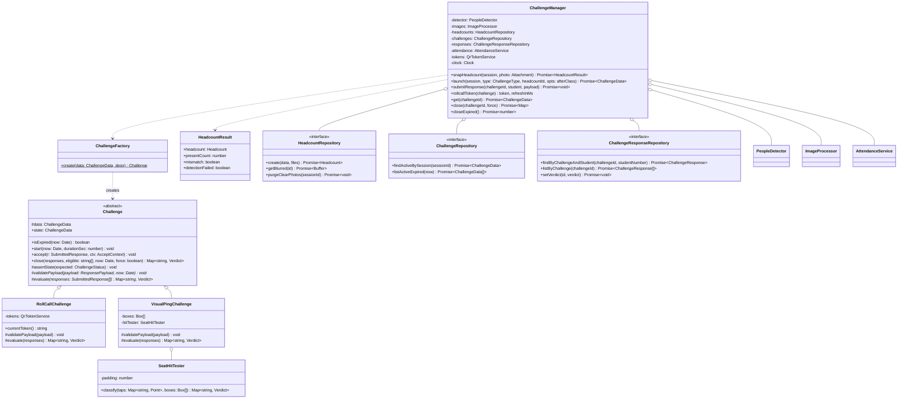
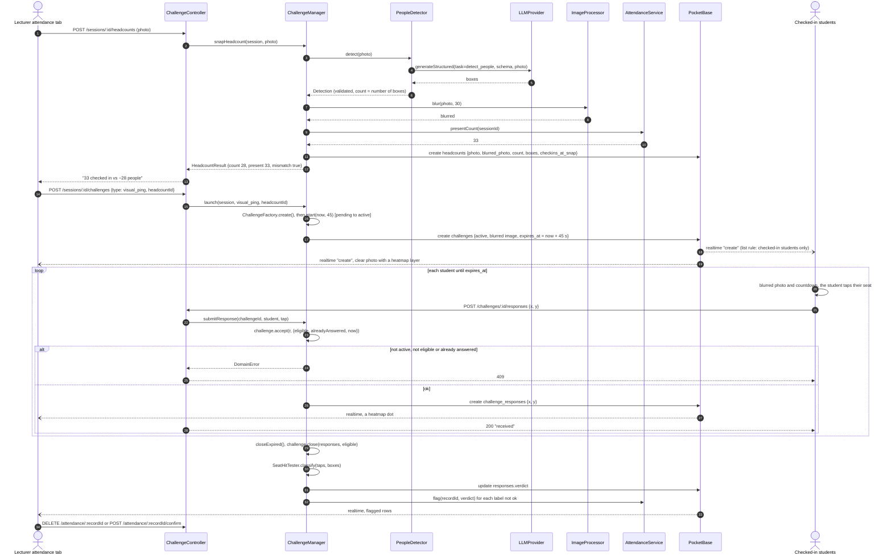
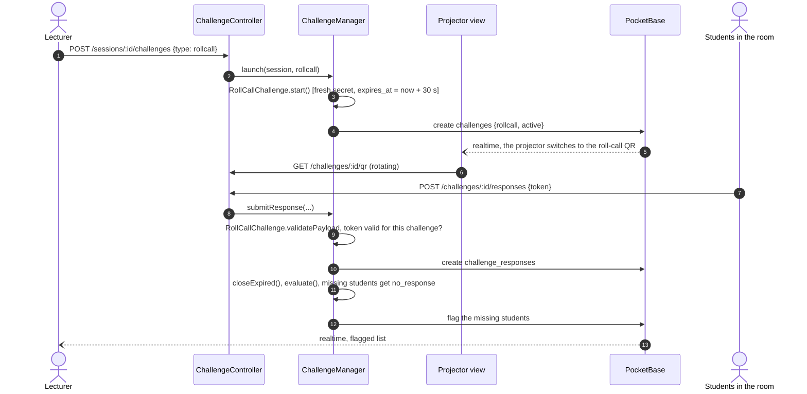

# EDD-AntiFraud

> Package `apps/api/src/challenge`. SDD §2.5. Covers FR-AF-01 … FR-AF-09.
> The spot check: "everyone who is here, point at your seat on this photo".

## 1. Classes: Template Method + State + Factory

The challenge's life (pending → active → closed) is the [Challenge state machine](README.md#challenge).

## 2. Algorithms and rules

- **Headcount.** `PeopleDetector` returns person boxes; the count is the number of valid boxes, so the number shown always matches the boxes drawn ([EDD-AI](ai.md)). The server blurs a copy (`ImageProcessor.blur`: downscale, blur, upscale, so faces cannot be recovered) and stores both; `mismatch` is true when present check-ins exceed the count by more than the tolerance (10 %).
- **Template Method.** `start`, `accept` and `close` fix the order of the guards: state, then expiry, then eligibility, then one answer per student. Subclasses supply only `validatePayload` (a Roll-call checks its own rotating token; a Visual Ping checks the tap is inside the photo) and `evaluate`. `close` adds `no_response` for every eligible student who did not answer, and flags every record whose label is not `ok`.
- **Eligibility.** Only students checked in (and not removed) when the challenge *started* are challenged; students who arrive later are not penalised.
- **`SeatHitTester`** (coordinates normalised to 0..1, each box padded by 0.03):
  - a tap inside no box → `empty_seat`;
  - two or more taps in the same box → `collision` for each (the lecturer decides who is real);
  - a tap inside two overlapping boxes → the nearest box centre wins;
  - no tap → `no_response`.
- **After class.** `launch(…, {afterClass: true})` is allowed only for a Visual Ping with a headcount, also on an ended lesson, and runs for 24 hours; it is answered from a card on the lesson page. The same `closeExpired` timer closes it.
- **One at a time.** A lesson has at most one active challenge.

## 3. Data

| Collection | Key fields | Rules |
|------------|-----------|-------|
| headcounts | session, photo (clear, lecturer only, deleted at lesson end), blurred_photo, people_count, confidence, boxes, checkins_at_snap | The lecturer reads all; the clear photo is a protected file |
| challenges | session, headcount, type, status, started_at, expires_at, **secret**, image (blurred) | Checked-in students read the active challenge of their lesson (and so receive its realtime event) |
| challenge_responses | challenge, student, student_number, x, y, responded_at, verdict | Unique (challenge, student_number); a student reads only their own |

## 4. Sequences

### SD2: Headcount and Visual Ping (UC-13, UC-02)

### SD3: Roll-call (UC-13 alternative)

## 5. Errors and edge cases

| Code | HTTP | When |
|------|------|------|
| `CHALLENGE_ACTIVE` | 409 | Launching while another challenge of the lesson is active |
| `PHOTO_REQUIRED` | 409 | An after-class check that is not a Visual Ping on a class photo |
| `NOT_FOUND` | 404 | A headcount that does not exist or belongs to another lesson |
| `SESSION_ENDED` | 409 | A live challenge on an ended lesson (only the after-class check is allowed) |
| `NOT_CHECKED_IN` | 409 | A response from a student who was not checked in when it started |
| Challenge state errors | 409 | Answering a closed challenge, or answering twice |

Edge cases: an LLM failure leaves the headcount with `detectionFailed` ("count unavailable"), and Roll-call still works; a student removed during the challenge is not labelled.

## 6. Configuration and performance

| Setting | Default |
|---------|---------|
| Roll-call / Visual Ping / after-class duration | 30 s / 45 s / 24 h |
| Mismatch tolerance | 10 % |
| Blur strength | σ = 30 (field test T6 checks the lowest σ where faces are unidentifiable) |
| Box padding | 0.03 |
| Class photo | ≤ 15 MB |
| Expiry timer | every 2 s (`index.ts`, shared with polls) |

## 7. Alternatives considered

| Alternative | Why not |
|-------------|---------|
| Face recognition per student | Privacy (NFR-04), consent, and accuracy in a lecture hall |
| Show students the clear photo | They would see each other's faces |
| Automatic removal of flagged records | The lecturer keeps the decision (FR-AF-07); `collision` is ambiguous by nature |
| Only Roll-call | A friend at the door can rescan for others; a seat tap is harder to fake from outside |

## 8. Testing

- **Unit:** `Challenge.test.ts` (template order, state, expiry, eligibility), `SeatHitTester.test.ts` (empty seat, collision, overlap, padding), `ChallengeManager.test.ts` (headcount mismatch, launch rules, after-class, close and flags), `PeopleDetector.test.ts`.
- **HTTP:** `app.challenge.test.ts` (roles, responses, roll-call token).
- **Integration:** `challenges.int.test.ts` (only checked-in students see the challenge, the secret and the clear photo are hidden).
- **E2E:** `challenge.spec.ts` (Visual Ping labels, after-class check from home).
