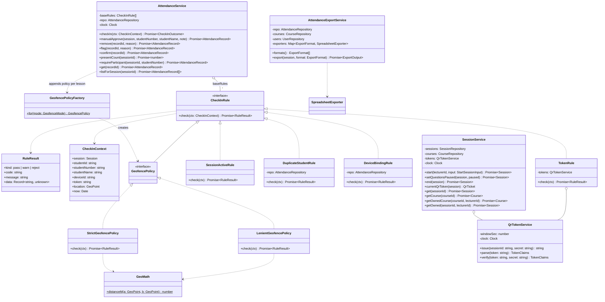
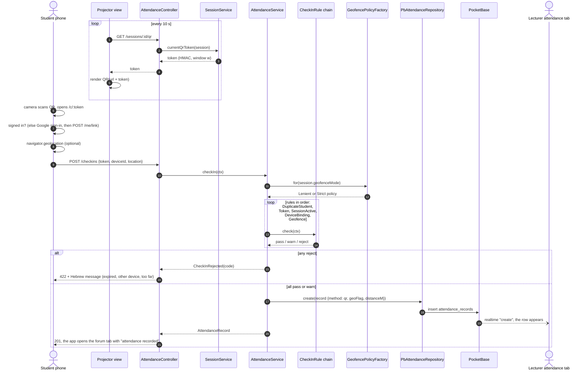

# EDD-Attendance

> Package `apps/api/src/attendance` (lessons, QR tokens, check-in, export). SDD §2.3. Covers FR-ATT-01 … FR-ATT-09.
> Courses, rosters and identity are in [EDD-Courses](courses.md).

## 1. Classes: Chain of Responsibility + Strategy

## 2. Algorithms and rules

- **Rotating token.** `QrTokenService.issue` signs `sessionId.window` with the lesson's secret (HMAC-SHA256); `window = floor(now / 10 s)`. `verify` accepts the current or the previous window only (≤ 20 s of delay), compares the signature in constant time, and rejects a token signed for another lesson. The secret never leaves the server.
- **Chain semantics.** Rules run in order: `DuplicateStudentRule`, `TokenRule`, `SessionActiveRule`, `DeviceBindingRule`, then the `GeofencePolicy` chosen for the lesson. The first `reject` stops the chain and becomes the message shown to the student; each `warn` sets a flag on the record and evaluation continues. The duplicate check runs first, so a student already present who reopens an old link sees their own record instead of "code expired"; it can only return the caller's own record.
- **Idempotency.** `ALREADY_CHECKED_IN` is turned into "return the existing record". Two concurrent scans by the same student are caught by the unique index `(session, student_number)`; the loser also gets the existing record.
- **Location.** `GeoMath.distanceM` is the haversine distance. The check credits the accuracy the phone reports, capped at 100 m, so an honest noisy fix passes but a 2 km fix cannot pass anywhere. Lenient flags a check-in beyond the radius; strict refuses it. A lesson with no location (the lecturer denied access) has no location check.
- **Identity key.** Records store the student key (`studentNumber`) as well as the user id, so a lecturer can approve by hand a student who never signed in.
- **Export.** `AttendanceExportService` sorts by arrival time and adds each student's sign-in email (looked up by user id); only a real 9-digit ID is printed.

## 3. Data

| Collection | Key fields | Rules |
|------------|-----------|-------|
| sessions | course, status, started_at, ended_at, geo_*, geofence_mode, **qr_secret**, questions_paused | Read by the lecturer and course members; written only by the API |
| attendance_records | session, student, student_number, device_id, method, distance_m, geo_flag, status, note | Unique (session, student_number); the lecturer reads all, a student only their own |

## 4. Sequences

### SD1: Student check-in (UC-01)

## 5. Errors and edge cases

| Code | HTTP | When |
|------|------|------|
| `TOKEN_INVALID` | 400 / 422 | A token that does not parse, or is signed for another lesson |
| `TOKEN_EXPIRED` | 422 | Older than the previous window |
| `SESSION_ENDED` | 422 | The lesson ended |
| `DEVICE_IN_USE` | 422 | Another student checked in from this device in this lesson |
| `DEVICE_MISSING` | 422 | No device id |
| `GEO_OUTSIDE`, `GEO_UNKNOWN` | 422 (strict) | Beyond the radius, or no location; in lenient mode a flag instead |
| `REMOVED` | 422 | The lecturer removed this student's record |
| `ONBOARDING_REQUIRED` | 409 | The user has no student key yet (the web app links first) |
| `NOT_CHECKED_IN` | 409 | `requireParticipant` for someone not present |
| `EXPORT_UNAVAILABLE` | 409 | Google Sheets export without a service account |

## 6. Configuration and performance

| Setting | Default | Where |
|---------|---------|-------|
| `QR_WINDOW_SEC` | 10 s (3 s in E2E) | env |
| Location radius | 50 m, lenient | per lesson |
| GPS accuracy credit | ≤ 100 m | `GeoMath` |

Budget (NFR-02): 80 check-ins in 30 s with server p95 < 500 ms, measured p95 183 ms (field test T1); a check-in is one rule chain plus one insert.

## 7. Alternatives considered

| Alternative | Why not |
|-------------|---------|
| A static QR per lesson | A photo sent to a friend at home would work all lesson |
| Strict location by default | Indoor GPS is often 30–100 m off (risk R-1); lenient flags instead of refusing |
| Bluetooth / Wi-Fi proximity | Needs an installed app (against KISS) |
| Face recognition | Privacy (NFR-04); counting plus challenges is enough ([EDD-AntiFraud](anti-fraud.md)) |

## 8. Testing

- **Unit:** `QrTokenService.test.ts` (windows, tampering), `rules.test.ts` (each rule and the chain order), `AttendanceService.test.ts` (idempotency, manual approval, flags), `SessionService.test.ts`, `exporters.test.ts`.
- **HTTP:** `app.test.ts` (check-in, roles, export formats).
- **Integration:** `attendance.int.test.ts` (unique index under concurrency, a student reads only their own record, the secret is hidden).
- **E2E:** `attendance.spec.ts` (check-in appears within 1 s, export, expired token, strict and lenient location).
