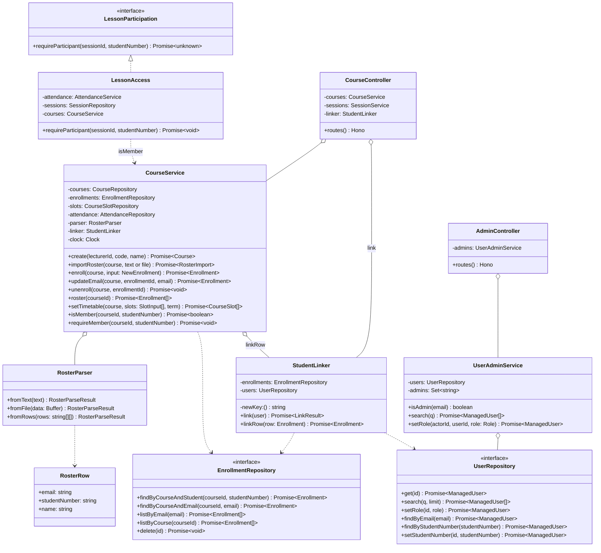
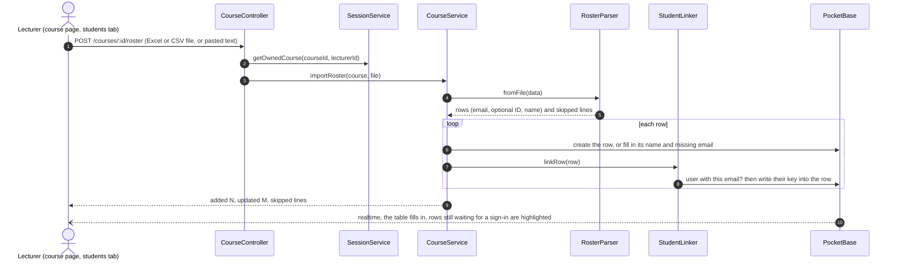
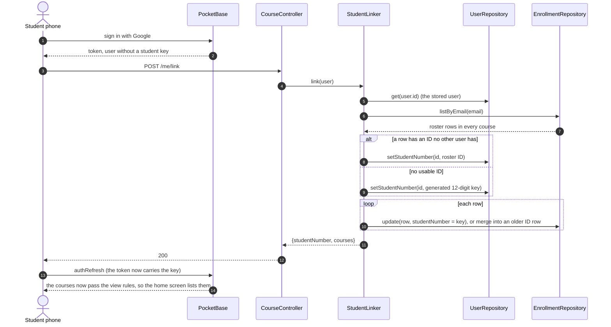
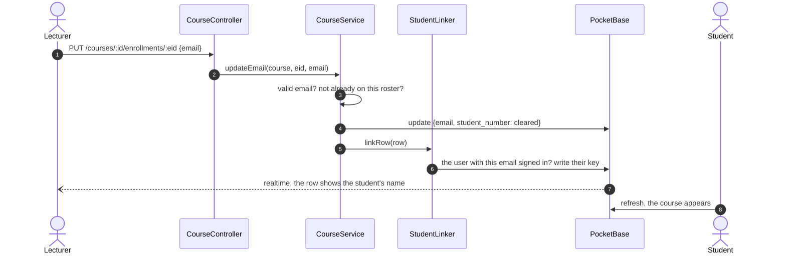
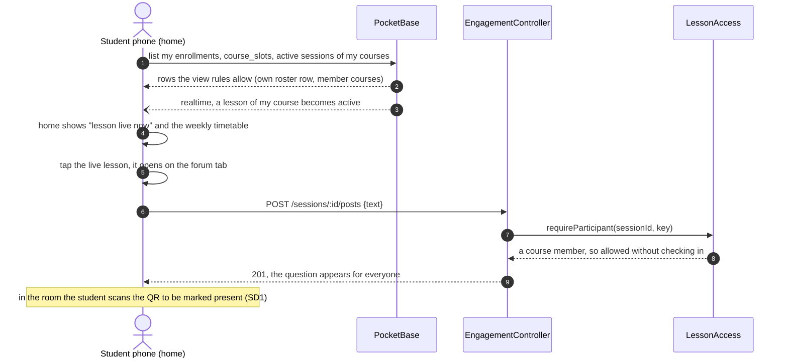

# EDD-Courses

> Courses, rosters, identity by email, the weekly timetable, who may take part in a lesson, and admins.
> Packages `apps/api/src/attendance` (`CourseService`, `RosterParser`, `StudentLinker`, `LessonAccess`) and
> `apps/api/src/admin`. SDD §2.4. Covers FR-AD-01, FR-AD-02, FR-EN-01 … FR-EN-05, FR-TT-01 … FR-TT-04, FR-BC-05.

## 1. Classes

## 2. Algorithms and rules

**Identity by email (the guest list at the door).** A student is known by the email they sign in with.
- Every user gets a **student key** (`users.student_id`) the first time `StudentLinker.link` runs (the web app calls `POST /me/link` right after sign-in): the 9-digit ID of a roster row with their email if no other user has it, otherwise the key they already have, otherwise a generated 12-digit key (12 digits, so it never looks like or collides with a real ID).
- `link` then writes that key into every roster row with the user's email. Membership in PocketBase rules compares `enrollments.student_number` with `@request.auth.student_id`, so writing the key is what opens the course. Rules also require the key to be non-empty, so an unlinked row (empty key) never matches a user without a key.
- `linkRow` does the same for one row when the lecturer adds it or fixes its email and that student has already signed in, so a fix takes effect at once. A lecturer's email is never linked.
- If the course already has an older ID-only row with the same key, the two rows are merged: the older row keeps its place and gains the email.
- `link` reads the stored user, not the caller's copy, so a second call cannot generate a second key (idempotent).

**Roster import (`RosterParser`).** One student per row, columns in any order: an email (validated, lowercased), an optional ID (5–9 digits, padded back to 9 because Excel drops leading zeros) and the name (the other cells). A row needs an email or an ID. Reads pasted text (tab, comma, semicolon or spaces), CSV/TSV in UTF-8 or Windows-1255, and the first sheet of an Excel file. Bad emails, rows with neither, and repeats (same email in any case, or same ID) are reported by line. An import adds rows and fills in names and missing emails; it never removes.

**Membership.** A course member is a student on the roster (linked) or one who attended any lesson of the course (`CourseService.isMember`, mirrored in PocketBase view rules). `LessonAccess.requireParticipant` admits a student checked in to the lesson or any course member, so a live lesson's forum, polls and "I'm lost" are open to the whole course (FR-BC-05); otherwise `NOT_IN_COURSE`.

**Timetable.** `setTimetable` replaces the weekly slots as a whole; times are `HH:MM`, a slot must end after it starts, and two slots on one day may not overlap (string comparison of `HH:MM` is time order).

**Admins.** Not a database role: `ADMIN_EMAILS` in the server configuration lists them, so nobody can make themselves an admin, and the `users` update rule stops users from changing their own `role`. An admin cannot change their own role, so the last admin cannot lock themselves out.

## 3. Data

| Collection | Key fields | Rules |
|------------|-----------|-------|
| users | email, name, student_id (unique when set), role | A user reads themselves, lecturers read users (to show who signed in); a user cannot change their own `role`, and may set `student_id` only while it is empty |
| courses | code, name, lecturer, term_start, term_end | Unique (lecturer, code) |
| enrollments | course, email, student_number, name, added_at | Unique (course, email) and (course, student_number), each when not empty; the lecturer reads all, a student only their own linked row |
| course_slots | course, weekday, starts, ends, room | Read by members and the lecturer |

## 4. Sequences

### SD9: Uploading the course roster (UC-19)

### SD10: First sign-in, linked by email (UC-01 2a, UC-05)

### SD11: Fixing an unmatched email (UC-20)

### SD8: Entering a live lesson from home (UC-05)

## 5. Errors and edge cases

| Code | HTTP | When |
|------|------|------|
| `COURSE_EXISTS` | 409 | The lecturer already has a course with this code |
| `EMPTY_ROSTER` | 409 | No row with an email or an ID |
| `INVALID_EMAIL` | 409 | A bad email, or neither an email nor an ID in `enroll` |
| `INVALID_STUDENT_NUMBER` | 409 | A key that is not 9 or 12 digits |
| `EMAIL_IN_ROSTER` | 409 | Fixing a row to an email already on the roster |
| `INVALID_TIMETABLE`, `TIMETABLE_OVERLAP`, `INVALID_TERM` | 409 | Bad day or time, overlapping slots, term end before start |
| `NOT_IN_COURSE` | 409 | Taking part in a lesson of a course you are not a member of |
| `OWN_ROLE` | 409 | An admin changing their own role |
| `NOT_FOUND` | 404 | A row of another course, a user that does not exist |

Edge cases: a roster ID that another user already has (a typo) gets a generated key, and the other user keeps theirs; moving a row to another email clears its link; an email in different case is the same student.

## 6. Configuration and performance

| Setting | Default | Where |
|---------|---------|-------|
| `ADMIN_EMAILS` | — | server env |
| Roster file | ≤ 5 MB | `CourseController` |
| Generated key | 12 digits | `StudentLinker` |

`link` reads the user's rows by email with one indexed query and updates at most one row per course.

## 7. Alternatives considered

| Alternative | Why not |
|-------------|---------|
| The student types an ID on first visit (the design until M14) | One more step, and a typo links the wrong person; the lecturer asked for email |
| Email as the key in every record | Every collection would change; the key stays internal and only the roster matches by email |
| Inviting students by an emailed link | Needs mail delivery and a second step; Google sign-in already proves the email |

## 8. Testing

- **Unit:** `RosterParser.test.ts` (emails, IDs, Hebrew CSV, Excel, duplicates, bad emails), `StudentLinker.test.ts` (new key, case, roster ID, taken ID, merge, idempotent, `linkRow`), `CourseService.test.ts` (import links at once, fix email, membership, timetable), `UserAdminService.test.ts`.
- **HTTP:** `app.course.test.ts` (routes, roles, `/me/link`), `app.admin.test.ts`.
- **Integration:** `enrollment.int.test.ts` (an email row opens the course only to its linked student; an empty key never matches), `admin.int.test.ts`.
- **E2E:** `enrollment.spec.ts` (course setup, live lesson from home, a mistyped email fixed by the lecturer).
