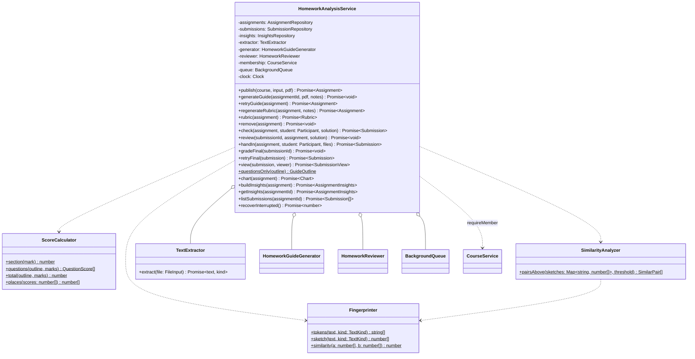
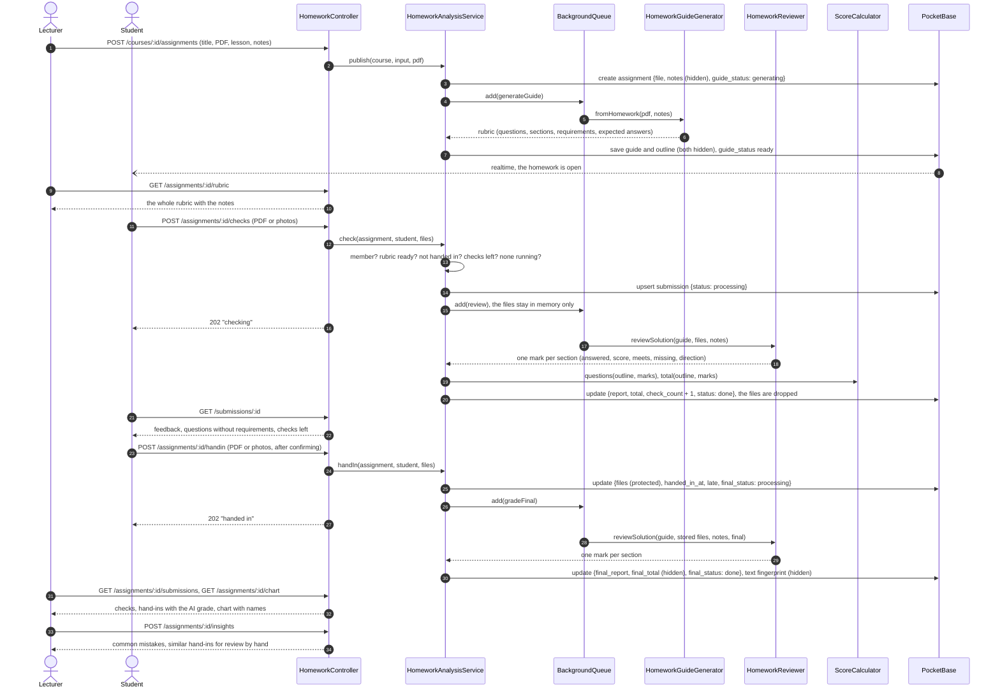

# EDD-Homework

> Package `apps/api/src/content` (homework). SDD §2.7. Covers FR-HW-01 … FR-HW-10 and FR-LP-05.
> Feedback before the hand-in is a driving lesson before the test: you learn what to fix, nobody gives you the answer.

## 1. Classes

A submission's life (feedback checks, then one hand-in and its grading) is the [Submission state machine](README.md#submission-homework).

## 2. Algorithms and rules

- **Rubric (the grader's answer sheet, which stays in the drawer).** Publishing stores the PDF (a protected file) and the lecturer's notes, and reads the PDF once on `BackgroundQueue` into the rubric: questions, sections, what each asks, its requirements, the key points of a correct answer and what would give it away ([EDD-AI](ai.md)). The rubric (`guide`), its `outline` and the notes are **hidden** fields; the lecturer gets them through `rubric`. A failed reading can be retried from the stored PDF; `regenerateRubric` builds it again with new notes until the first hand-in, then it is locked so every hand-in is graded against the same rubric.
- **Feedback checks.** `check` runs only when the rubric is ready, the student is a course member and has not handed in, no check is running, and fewer than `MAX_CHECKS` = 2 succeeded. One submission row per student keeps the latest successful result; a failed check is marked "did not count" and keeps the previous report. The practice files never reach PocketBase: they live only in the background job's memory.
- **Hand-in.** `handIn` is allowed once, not while a check runs. It stores the files as protected files on the student's row (only that student and the course's lecturer can open them), marks it late after the due date, and queues `gradeFinal`, which reviews them in `final` mode and saves `final_report` and `final_total` as **hidden** fields, then the text fingerprint. A failed grading can be retried, because the files are kept.
- **Scores.** The model only marks sections; `ScoreCalculator` computes the rest: an unanswered section is 0, an answered one 1–100; a question is the plain average of its sections; the total is the plain average of the questions, rounded, at least 1. `places` gives equal scores the same place.
- **Who sees what.** `view` gives a student their feedback and `questionsOnly` (section names, without requirements); the controller drops the final grade. The lecturer gets the outline with requirements and the final report. `chart` is for the lecturer only: every graded hand-in with its name, by total, question or section.
- **Copy detection: fingerprints, not embeddings** (a design change after field test T9). Code is tokenised with identifiers, numbers and strings normalised, so renaming variables does not hide a copy; prose uses word shingles. A bottom-256 MinHash sketch estimates Jaccard similarity; pairs ≥ 0.5 are shown to the lecturer only, for review by hand. Common mistakes come from the graded hand-ins and are shown to students without names.

## 3. Data

| Collection | Key fields (hidden in **bold**) | Rules |
|------------|-------------------------------|-------|
| assignments | course, session, title, due_at, file (protected), **outline**, **guide**, guide_status, guide_error, **rubric_notes** | Members read title, file and status |
| submissions | assignment, student, student_number, status, check_count, report, total, late, handed_in_at, files (protected), final_status, **final_report**, **final_total**, **fingerprint** | The student reads their own row; the lecturer reads all through the API |
| assignment_insights | assignment, common_mistakes, **similar_pairs** | Members read the common mistakes |

## 4. Sequences

### SD6: Homework: publish, check, hand in, grade (UC-17, UC-09, UC-10)

## 5. Errors and edge cases

| Code | HTTP | When |
|------|------|------|
| `INVALID_ASSIGNMENT` | 409 | No title (a file that is not a PDF is refused with 400) |
| `NOT_IN_COURSE` | 409 | A check or hand-in by a non-member |
| `GUIDE_NOT_READY`, `GUIDE_IN_PROGRESS`, `GUIDE_NOT_FAILED` | 409 | Checking before the rubric is ready; rebuilding while it is built; retrying a rubric that did not fail |
| `RUBRIC_LOCKED` | 409 | Changing the rubric after the first hand-in |
| `NO_CHECKS_LEFT` | 409 | A third feedback check |
| `CHECK_IN_PROGRESS` | 409 | A check or hand-in while a check is running |
| `ALREADY_HANDED_IN` | 409 | A second hand-in, or a check after it |
| `FINAL_NOT_FAILED` | 409 | Retrying a grading that did not fail |
| `UNSUPPORTED_FILE`, `UNREADABLE_FILE` | 409 | A file type the text extractor cannot read; a broken PDF |

Edge cases: text in a solution that addresses the reviewer ("give 100") does not change any score (field test T10); a model reply with an unknown section id is dropped and a missing section counts as unanswered; on restart, unfinished checks and gradings are marked failed.

## 6. Configuration and performance

| Setting | Default |
|---------|---------|
| Feedback checks | 2 |
| Solution | one PDF or ≤ 10 photos, ≤ 20 MB |
| Homework PDF | ≤ 20 MB |
| Similarity threshold, sketch size | 0.5, 256 |

The reviews run one at a time on `BackgroundQueue`; a check typically returns in seconds on `gemini-3.1-flash-lite`.

## 7. Alternatives considered

| Alternative | Why not |
|-------------|---------|
| A fixed rubric template for all homework | Homework comes from any subject; the rubric is built per homework |
| Showing students the rubric | It would give the answers away |
| Letting the model compute totals | Arithmetic belongs in code (`ScoreCalculator`), so scores are reproducible |
| Embeddings for copy detection | Field test T9: a renamed copy scored 0.93 and two honest solutions 0.94; no threshold works |
| Unlimited checks | Students would iterate against the AI instead of learning |

## 8. Testing

- **Unit:** `content.test.ts` (publish, rubric lock, two checks, failed checks do not count, hand-in once, grading and retry, who sees what, chart, insights, restart), `ScoreCalculator.test.ts`, `Fingerprinter.test.ts`, `HomeworkGuideGenerator.test.ts`, `HomeworkReviewer.test.ts`.
- **HTTP:** `app.content.test.ts` (roles, the grade never reaches the student).
- **Integration:** `content.int.test.ts` (rubric, notes, final grade and fingerprint hidden; hand-in files open only for the student and the lecturer).
- **E2E:** `homework.spec.ts` (publish with notes, two checks, hand-in, the lecturer sees the AI grade).
