# EDD-Infrastructure

> Package `apps/api/src/infra`: persistence, exports, images, uploads, background jobs, locks and time.
> SDD §2.9. Serves FR-ATT-09, FR-FB-04 (exporters), FR-AF-04 (blur), FR-VS-01 (chunked upload), NFR-06, NFR-07.

## 1. Classes: Repository + Strategy

```mermaid
classDiagram
  direction TB
  class Repository~T~ {
    <<interface>>
    +get(id: string) Promise~T | null~
    +create(data: Omit~T, id~) Promise~T~
    +update(id: string, data: Partial~T~) Promise~T~
  }
  class PbRepository~T~ {
    <<abstract>>
    #pb: PocketBase
    #col: RecordService
    #toEntity(rec)* T
    #toRecord(e: Partial~T~)* Record
    #first(filter, params) Promise~T | null~
  }
  class InMemoryRepository~T~ {
    #items: Map~string, T~
    #all() T[]
  }
  class PbAttendanceRepository
  class PbSessionRepository
  class PbEnrollmentRepository
  class PbFeedPostRepository {
    -voteLock: KeyedLock
    +incrementVotes(id) Promise~void~
  }
  class PbUserRepository {
    +findByEmail(email) Promise~ManagedUser~
    +findByStudentNumber(n) Promise~ManagedUser~
    +setStudentNumber(id, n) Promise~ManagedUser~
  }
  class InMemoryEnrollmentRepository {
    -checkUnique(e, self) void
  }
  class KeyedLock {
    +run~T~(key, task) Promise~T~
  }
  class ImageProcessor {
    <<interface>>
    +normalize(img: Buffer) Promise~Buffer~
    +blur(img: Buffer, sigma: number) Promise~Buffer~
  }
  class SharpImageProcessor
  class SpreadsheetExporter {
    <<interface>>
    +export(table: Table, meta: SessionMeta) Promise~ExportOutput~
  }
  class Table {
    +name: string
    +suffix: string
    +headers: string[]
    +rows: cell[][]
    +widths: number[]
  }
  class XlsxExporter
  class CsvExporter
  class GoogleSheetsExporter {
    -client: sheets_v4.Sheets
    -spreadsheetId: string
  }
  class UploadStore {
    +append(id, offset, data) Promise~number | null~
    +size(id) Promise~number~
    +path(id) string
    +remove(id) Promise~void~
  }
  class BackgroundQueue {
    +add(name, job) void
    +idle() Promise~void~
  }
  class Clock {
    <<interface>>
    +now() Date
  }
  class SystemClock
  class FixedClock {
    +advance(ms: number) void
  }

  Repository~T~ <|.. PbRepository~T~
  Repository~T~ <|.. InMemoryRepository~T~
  PbRepository~T~ <|-- PbAttendanceRepository
  PbRepository~T~ <|-- PbSessionRepository
  PbRepository~T~ <|-- PbEnrollmentRepository
  PbRepository~T~ <|-- PbFeedPostRepository
  InMemoryRepository~T~ <|-- InMemoryEnrollmentRepository
  PbFeedPostRepository o-- KeyedLock
  ImageProcessor <|.. SharpImageProcessor
  SpreadsheetExporter <|.. XlsxExporter
  SpreadsheetExporter <|.. CsvExporter
  SpreadsheetExporter <|.. GoogleSheetsExporter
  SpreadsheetExporter ..> Table
  Clock <|.. SystemClock
  Clock <|.. FixedClock
```

Every package defines its own repository interfaces (for example `AttendanceRepository extends Repository<AttendanceRecord>`, `EnrollmentRepository`); each has a `Pb*` implementation for production and an `InMemory*` one for unit tests. `PbUserRepository` implements `UserRepository` directly (users are not a generic entity).

## 2. Algorithms and rules

- **No query language in the domain.** Queries are named repository methods (`findByCourseAndEmail`, `listOpenExpired`), never PocketBase filter strings, so the domain does not depend on PocketBase ([ADR-001](../adr/ADR-001-database.md)).
- **In-memory fakes behave like the database.** Unique checks in `InMemory*` repositories are synchronous, so they fail under concurrency exactly like the database's unique index (for example `(course, email)` and `(course, student_number)` when not empty).
- **`KeyedLock`.** PocketBase's `votes+` is a read-modify-write in Go, not an atomic update. An integration test fired 12 concurrent upvotes from 6 students: all 6 were accepted but only 2 counted. `PbFeedPostRepository` now serialises increments per post inside the API process. Valid because the API runs as one instance; scaling out would need a database-side counter.
- **Exporters.** One `Table` (headers, rows, column widths) goes to any `SpreadsheetExporter`: `.xlsx` with a right-to-left sheet, `.csv` with a UTF-8 BOM so Excel shows Hebrew, or a new tab in a Google Sheet. The file name is `date course title [suffix]`.
- **Blur.** `SharpImageProcessor.blur` downscales to 480 px, blurs, scales back to 1200 px and blurs again, then re-encodes as JPEG: faces are unrecoverable while seats stay visible. `normalize` rotates by EXIF and limits the size before the AI sees the photo.
- **Chunked uploads.** `UploadStore.append` writes at the given offset: a repeated chunk returns the current size (ignored), a gap returns `null` (rejected).
- **Background jobs.** `BackgroundQueue` runs jobs one at a time in memory; `idle()` lets tests wait for them. On restart, services mark unfinished jobs failed (`recoverInterrupted`).
- **Time.** All "now" comes from `Clock`; tests use `FixedClock.advance` to cross windows, cooldowns and deadlines.

## 3. Data
The repositories map entities to the collections in the [data dictionary](../04-srs.md#b-data-dictionary). Newer collections have explicit `*_at` date fields set from `Clock` (they have no automatic `created`); number fields default to 0 in PocketBase, so "none" is stored as −1 and mapped back to `undefined` or `null`.

## 4. Sequences
Infrastructure appears inside the other sequences: repositories in all of them, `UploadStore` and `BackgroundQueue` in SD5, `KeyedLock` in SD7, `ImageProcessor` in SD2.

## 5. Errors and edge cases
- A PocketBase 404 becomes `null` from `get`/`first` and a `NotFoundError` in the service; other PocketBase errors propagate as 500.
- A write refused by a missing create/update rule returns 403 from PocketBase: only the superuser API writes those collections.
- Google Sheets export without a configured service account is not offered (`EXPORT_UNAVAILABLE`).

## 6. Configuration and performance

| Setting | Where |
|---------|-------|
| `PB_URL`, `PB_SUPERUSER_EMAIL`, `PB_SUPERUSER_PASSWORD` | env |
| `GOOGLE_SERVICE_ACCOUNT_FILE`, `GOOGLE_SHEETS_ID` | env (optional) |
| Upload chunk | 50 MB |
| Container memory | PocketBase 160 MB, API 320 MB, nginx 48 MB |

## 7. Alternatives considered

| Alternative | Why not |
|-------------|---------|
| Calling the PocketBase SDK from services | Ties the domain to PocketBase and makes unit tests need a database |
| An ORM over SQLite | PocketBase already owns the database and its access rules |
| A Redis job queue | One more service on a 1 GB server; one API instance is enough |
| Canvas blur in the browser | The clear photo would reach students' phones |

## 8. Testing
- **Unit:** `exporters.test.ts` (CSV escaping and BOM, RTL workbook, email column), `Clock.test.ts`; every domain test uses the `InMemory*` repositories.
- **Integration:** the `Pb*` repositories against a real PocketBase (all `*.int.test.ts`), including the concurrent upvote test for `KeyedLock`.
