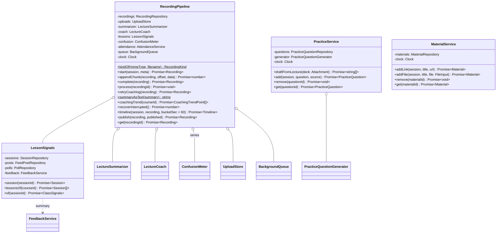
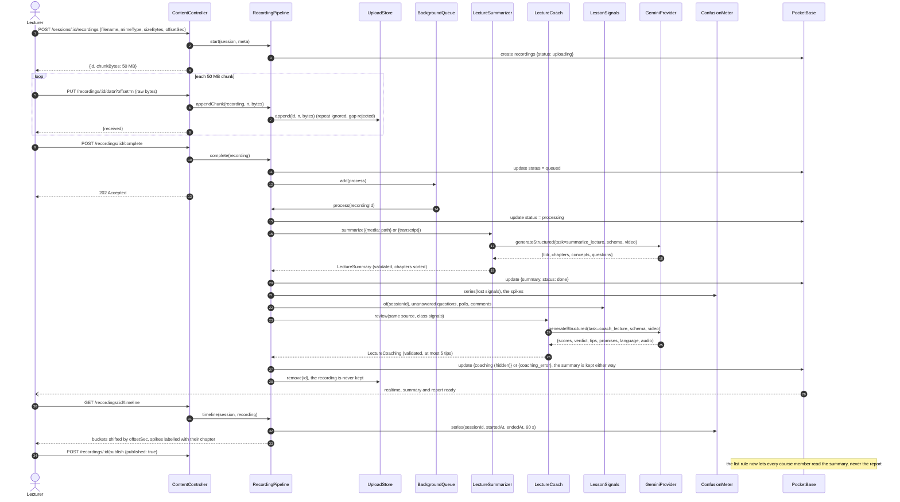

# EDD-LectureContent

> Package `apps/api/src/content`: lecture recordings into a summary for students and a report for the lecturer,
> and the lecture page (materials, review questions). SDD §2.7. Covers FR-VS-01 … FR-VS-07, FR-LP-01 … FR-LP-04.
> Homework is in [EDD-Homework](homework.md).

## 1. Classes

The recording's life (uploading → queued → processing → done or failed) is the [Recording state machine](README.md#recording).

## 2. Algorithms and rules

- **Chunked upload.** Cloudflare caps a request at 100 MB, so the browser sends 50 MB chunks, each with its byte offset: a repeated chunk is ignored and a gap is rejected, so retries are safe. `complete` checks every byte arrived and queues the job.
- **Processing.** `BackgroundQueue` runs one job at a time (to stay inside the AI quota). `process` writes the summary first, then the lecturer report from the same source, and **deletes the file whatever happens**: the recording is never stored.
- **Summary (for students).** `LectureSummarizer` returns a TL;DR, timestamped chapters, key concepts and 5 review questions ([EDD-AI](ai.md)). The lecturer publishes it; then course members read it.
- **Lecturer report (a coach watching the tape with you).** `LectureCoach.review` gets the same source plus `ClassSignals` from `LessonSignals`: "I'm lost" spikes, unanswered questions, each closed poll's share of correct answers and the comment distribution. It returns three scores (1–5), 3–5 tips each tied to a moment, promises not kept, language slips and, for a recording, sound notes. Stored in the **hidden** `coaching` field, so students can read a published summary but never its report. A failed report never fails the summary; `retryCoaching` rebuilds it from `summaryAsText` (the recording is gone). `coachingTrend` lists each lesson's three scores for the course chart.
- **Timeline.** Each 60 s bucket of "I'm lost" signals moves onto the recording clock: t = (signal − lesson start) − `offsetSec`. A spike is a bucket with at least `max(2, 10 % of those present)` students, labelled with the chapter it falls in.
- **Restart.** Jobs live in memory, so on startup `recoverInterrupted` marks anything unfinished as failed with "please upload again", instead of leaving it "processing" forever.
- **Lecture page.** `PracticeService` publishes open review questions (no options, nothing to submit); `draftFromLecture` returns up to 8 AI drafts and the lecturer publishes the ones they tick. `MaterialService` accepts http(s) links and files up to 50 MB, stored as protected files (download needs a short-lived file token). Everything is read straight from PocketBase by course members.

## 3. Data

| Collection | Key fields (hidden in **bold**) | Rules |
|------------|-------------------------------|-------|
| recordings | session, kind, filename, size_bytes, offset_sec, status, error, summary, published, **coaching**, coaching_error | The lecturer reads all; members read published ones |
| materials | session, title, kind, url, file (protected), filename | Members read |
| practice_questions | session, question, source | Members read |

## 4. Sequences

### SD5: Lecture summary, the lecturer report and the "I'm lost" timeline (UC-15)

## 5. Errors and edge cases

| Code | HTTP | When |
|------|------|------|
| `UNSUPPORTED_FILE` | 409 | A recording that is not video, audio or a transcript (a deck that is not PDF or an image is refused with 400) |
| `FILE_TOO_LARGE` | 409 | Over 2 GB (media), 2 MB (transcript) or 50 MB (material) |
| `UPLOAD_TOO_LONG` | 409 | A chunk that goes past the size declared at the start |
| `UPLOAD_GAP`, `UPLOAD_INCOMPLETE`, `UPLOAD_CLOSED` | 409 | A chunk after a gap; completing before all bytes arrived; uploading to a finished recording |
| `NOT_READY` | 409 | Timeline, publish or report of a recording that is not done |
| `INVALID_LINK`, `INVALID_QUESTION` | 409 | A non-http(s) link; an empty review question |
| `EMPTY_FILE` | 409 | An empty material file |

## 6. Configuration and performance

| Setting | Default |
|---------|---------|
| Chunk size | 50 MB |
| Media / transcript / material | ≤ 2 GB / ≤ 2 MB / ≤ 50 MB |
| Timeline bucket, spike threshold | 60 s, max(2, 10 % present) |
| Review question drafts | up to 8 |

A 90-minute video fits the model's context at low media resolution (~66 tokens per frame); large files go through the Gemini Files API. Measured: an 88 s lecture summarised in 12–17 s end to end (field test T3, pilot).

## 7. Alternatives considered

| Alternative | Why not |
|-------------|---------|
| Speech-to-text, then a text model | Two services and two failure points; Gemini takes the video directly |
| Keeping the recording | Storage and privacy; only the summary and report are needed |
| One long AI report | The lecturer wants a few concrete tips, not 70 pages |
| A database job queue | One API instance is enough; restart recovery covers the gap |

## 8. Testing

- **Unit:** `content.test.ts` (chunks, gaps, processing, the file always deleted, a report failure keeps the summary, retry, trend, timeline spikes, restart recovery), `LectureCoach.test.ts` (score clamping, tip limits), `lecture.test.ts` (materials, review questions).
- **HTTP:** `app.content.test.ts` (roles, report hidden from students), `app.lecture.test.ts`.
- **Integration:** `content.int.test.ts` (`coaching` hidden from everyone through PocketBase), `lecture.int.test.ts` (members read materials and review questions).
- **E2E:** `lecture.spec.ts` (materials, review questions, the lecture page for a student who missed it).
