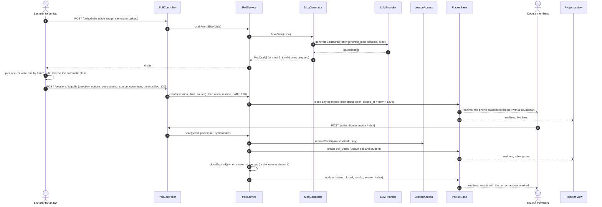
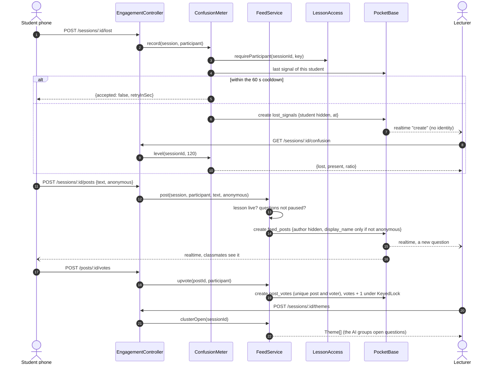

# EDD-LiveClass

> Package `apps/api/src/engagement`: "I'm lost", the lesson and course forum, polls, and anonymous lecture comments.
> SDD §2.6. Covers FR-BC-01 … FR-BC-07, FR-PL-01 … FR-PL-05, FR-FB-01 … FR-FB-04.

## 1. Classes

```mermaid
classDiagram
  direction TB
  class LessonParticipation {
    <<interface>>
    +requireParticipant(sessionId, studentNumber) Promise~unknown~
  }
  class ConfusionMeter {
    -signals: LostSignalRepository
    -attendance: LessonParticipation and presentCount
    -clock: Clock
    -cooldownSec: number = 60
    +record(session, student: Participant) Promise~LostOutcome~
    +level(sessionId, windowSec = 120) Promise~ConfusionLevel~
    +series(sessionId, from, to, bucketSec = 60) Promise~TimePoint[]~
  }
  class FeedService {
    -posts: FeedPostRepository
    -votes: PostVoteRepository
    -attendance: LessonParticipation
    -courses: CourseService
    -clusterer: FeedClusterer
    -clock: Clock
    +post(session, author: Participant, text, anonymous) Promise~FeedPost~
    +postToCourse(course, author: Participant, text, anonymous) Promise~FeedPost~
    +upvote(postId, voter: Participant) Promise~void~
    +markAnswered(postId, answered) Promise~FeedPost~
    +answer(postId, text) Promise~FeedPost~
    +clusterOpen(sessionId) Promise~Theme[]~
    +get(postId) Promise~FeedPost~
  }
  class PollService {
    -polls: PollRepository
    -votes: PollVoteRepository
    -attendance: LessonParticipation
    -generator: McqGenerator
    -clock: Clock
    +normalizeDraft(draft: McqDraft)$ McqDraft
    +checkDuration(durationSec)$ void
    +draftFromSlide(slide: Attachment) Promise~McqDraft[]~
    +create(session, draft: McqDraft, source) Promise~Poll~
    +open(session, pollId, durationSec) Promise~Poll~
    +vote(pollId, student: Participant, optionIndex) Promise~void~
    +close(pollId) Promise~PollResults~
    +closeExpired() Promise~number~
    +get(pollId) Promise~Poll~
  }
  class FeedbackService {
    -feedback: LessonFeedbackRepository
    -courses: CourseService
    -clock: Clock
    +status(session, student: Participant) Promise~FeedbackStatus~
    +submit(session, student: Participant, rating: FeedbackRating, comment) Promise~void~
    +summary(sessionId) Promise~FeedbackSummary~
  }
  class CommentsExportService {
    -posts: FeedPostRepository
    -feedback: LessonFeedbackRepository
    -courses: CourseRepository
    -exporters: Map~ExportFormat, SpreadsheetExporter~
    +export(session, format) Promise~ExportOutput~
    +table(posts, feedback)$ Table
  }
  class LessonAccess

  LessonParticipation <|.. LessonAccess
  ConfusionMeter ..> LessonParticipation : who may take part
  FeedService ..> LessonParticipation
  PollService ..> LessonParticipation
  FeedService ..> CourseService : requireMember (course forum)
  FeedbackService ..> CourseService : requireMember
  FeedService o-- FeedClusterer
  PollService o-- McqGenerator
  CommentsExportService ..> SpreadsheetExporter
```

## 2. Algorithms and rules

- **Who may take part.** `LessonAccess` (see [EDD-Courses](courses.md)) admits anyone checked in to the lesson or any course member, so students at home can follow a live lesson. PocketBase list rules give members the forum and every non-draft poll, so they also receive the live events.
- **"I'm lost".** One signal per student per 60 s; a repeat returns `{accepted: false, retryInSec}` instead of an error, so pressing twice never shows a failure. `level` counts *distinct* students in the last 120 s, relative to those present. The student is stored in a **hidden** field: the lecturer sees how many, never who. `series` buckets signals per minute for the lecture timeline ([EDD-LectureContent](lecture-content.md)).
- **Forum.** Every post has a course; a post with no lesson is in the course forum. `post` needs a live lesson (`SESSION_ENDED` otherwise) and refuses while the lecturer paused questions (`QUESTIONS_PAUSED`); `postToCourse` needs course membership only. An anonymous post keeps its author in hidden fields. Upvotes are unique per (post, voter); the counter is incremented under a `KeyedLock` because PocketBase's `votes+` is not atomic ([EDD-Infrastructure](infra.md)). `answer` stores the lecturer's answer and marks the post answered.
- **Polls.** `normalizeDraft` trims and requires a question and 2–6 non-empty options, and a correct answer that exists (or none: an opinion poll). `open` closes any other open poll of the lesson, so phones never show two; with `durationSec` (30 s–30 min) it sets `closesAt`, and `closeExpired` (the 2-second timer) closes it. `close` is idempotent and stores the tally; the correct answer lives in a **hidden** field and is copied to `answer_index` only on close. One vote per student (an `exists` check gives `ALREADY_VOTED`; the unique index catches the concurrent case).
- **Comments.** Open to every course member for 7 days after the lesson ends, once each. The `lesson_feedback` collection has no list or view rule, so nobody, the lecturer included, can read a single answer. `summary` returns only the count until there are 3 answers, then counts per option and the comments ordered by option and text, never by time, so their order cannot reveal who wrote them.
- **Export.** `CommentsExportService.table` builds one table: the questions by upvotes with answers (a name only where the student posted with one), then the comments, from 3 answers, without times or names.

## 3. Data

| Collection | Key fields (hidden in **bold**) | Rules |
|------------|-------------------------------|-------|
| lost_signals | session, **student**, **student_number**, at | The lecturer reads counts through the API |
| feed_posts | course, session, **author**, **author_number**, display_name, anonymous, text, votes, answered, answer | Read by the lecturer and course members |
| post_votes | post, voter, voter_number | Unique (post, voter_number) |
| polls | session, question, options, **correct_index**, answer_index, status, source, results, closes_at | Members read every non-draft poll |
| poll_votes | poll, student, student_number, option_index | Unique (poll, student_number) |
| lesson_feedback | session, **student**, **student_number**, rating, comment | No list or view rule at all |

## 4. Sequences

### SD4: A poll from a slide (UC-14, UC-04)

### SD7: "I'm lost" and the forum (UC-03)

## 5. Errors and edge cases

| Code | HTTP | When |
|------|------|------|
| `NOT_IN_COURSE` | 409 | Taking part without being a course member |
| `SESSION_ENDED` | 409 | Asking in, voting in or opening a poll of an ended lesson |
| `QUESTIONS_PAUSED` | 409 | Asking while the lecturer paused questions |
| `INVALID_POLL` | 409 | Empty question, fewer than 2 or more than 6 answers, an answer that does not exist |
| `INVALID_DURATION` | 409 | A poll timer outside 30 s–30 min |
| `POLL_STATE`, `POLL_CLOSED` | 409 | Opening a poll that is not a draft; voting in a closed poll |
| `INVALID_OPTION` | 409 | A vote or comment option that does not exist |
| `ALREADY_VOTED`, `ALREADY_SENT` | 409 | A second vote, a second comment |
| `FEEDBACK_NOT_OPEN`, `FEEDBACK_CLOSED` | 409 | Commenting before the lesson ends or after 7 days |
| `EXPORT_UNAVAILABLE` | 409 | Google Sheets export without a service account |

## 6. Configuration and performance

| Setting | Default |
|---------|---------|
| "I'm lost" cooldown / window | 60 s / 120 s |
| Poll timer | 120 s default, 30 s–30 min |
| Comment window / minimum shown | 7 days / 3 answers |
| Slide image | ≤ 10 MB |

Realtime: a vote or post reaches the projector and phones through PocketBase in < 1 s (NFR-02).

## 7. Alternatives considered

| Alternative | Why not |
|-------------|---------|
| Our own WebSocket server | PocketBase realtime already applies the access rules to every event |
| An external quiz tool | A second app and a room code (against KISS) |
| Showing the lecturer who is lost | Students stop pressing it; anonymity is the point |
| Comments sorted by time | Order reveals who wrote what in a small class |

## 8. Testing

- **Unit:** `engagement.test.ts` (cooldown, distinct students, forum rules, paused questions, poll drafts, timers, one vote), `feedback.test.ts` (window, members, 3-answer rule), `comments-export.test.ts`.
- **HTTP:** `app.engagement.test.ts`, `app.lecture.test.ts` (comments export, roles).
- **Integration:** `engagement.int.test.ts` (hidden authors and correct answer, members at home see open polls, concurrent upvotes counted once each).
- **E2E:** `engagement.spec.ts` ("I'm lost" with a note), `lecture.spec.ts` (poll from a slide with a countdown, hand-written poll, course forum), `feedback.spec.ts` (comments and export).
