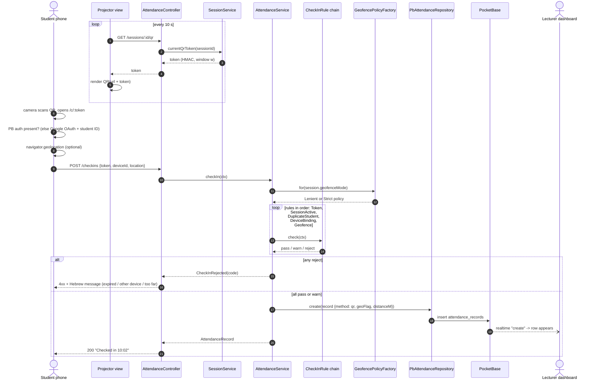
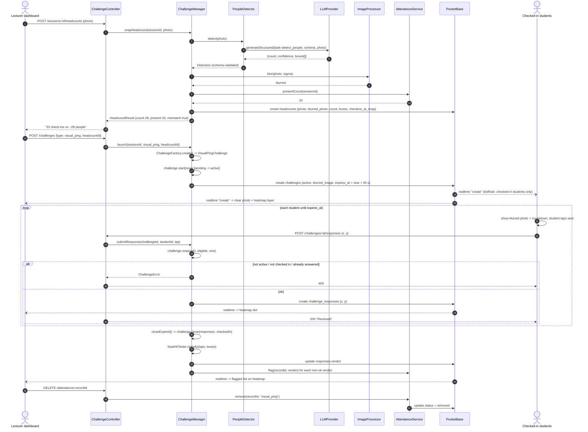
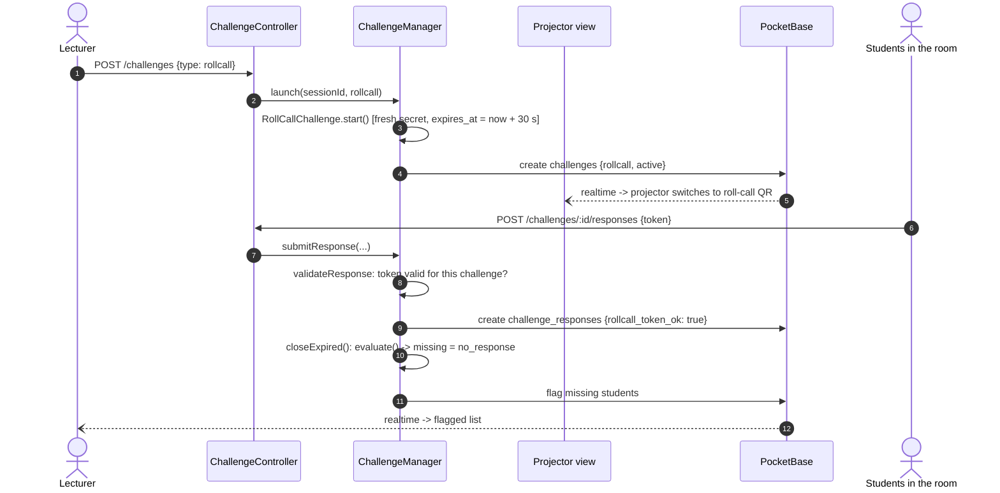
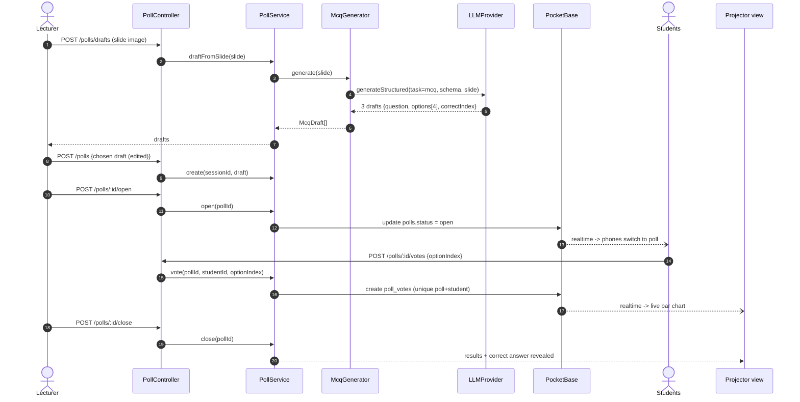
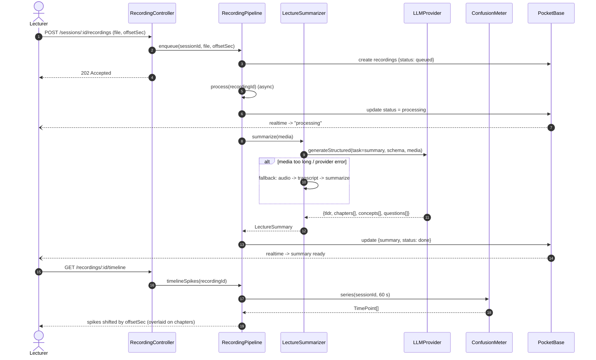
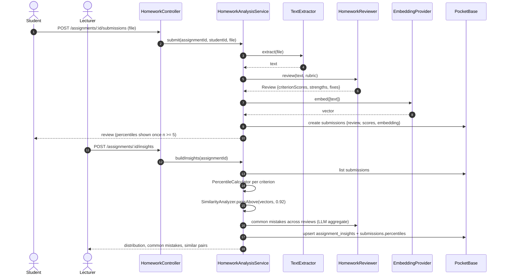

# Sequence Diagrams: ClassPulse

The participants are the classes from [06-class-diagrams.md](06-class-diagrams.md). `PB` stands for PocketBase, which the API reaches through the `Pb*Repository` classes.

## SD1: Student check-in (UC1)

## SD2: Headcount + Blurred Photo Heatmap Challenge (UC4, UC5)

## SD3: Roll-call challenge (UC4 alternative)

## SD4: AI poll from slide (UC8, UC7)

## SD5: Lecture summary with confusion timeline (UC9)

## SD6: Homework review (UC10, UC11)

